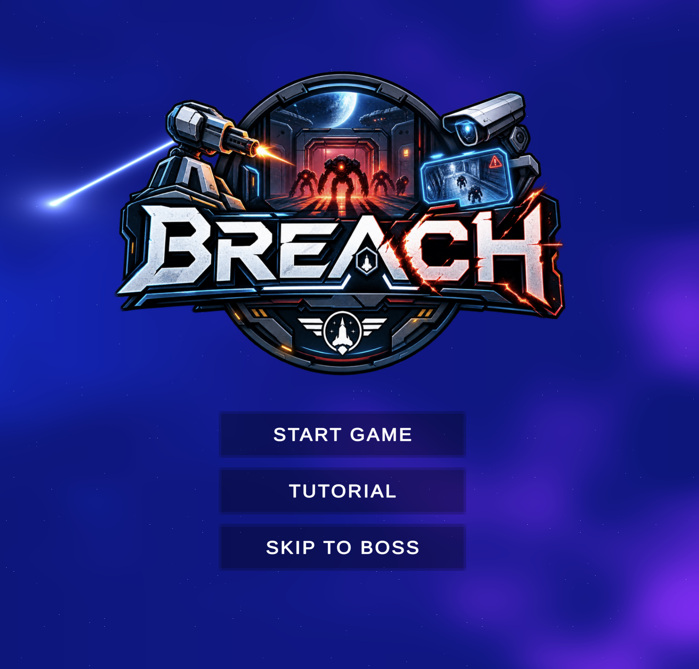

# Game Design Document (GDD): BREACH

Breach logo (`Images/Logo.png`)

**Team logo, AI concept generated via ChatGPT.**

> **Status:** Updated design draft

> **Last updated:** 4 November 2026

> **Team:** Techtonic (Members: Rongze Han, Marcus Minnelli, Rishabh Maheshwari, Hitarrth Chheda)

---
## Table of Contents
1\. [Game Overview](#1-game-overview)

2\. [Story and Narrative](#2-story-and-narrative)

3\. [Gameplay and Mechanics](#3-gameplay-and-mechanics)

4\. [Levels and World Design](#4-levels-and-world-design)

5\. [Art and Audio](#5-art-and-audio)

6\. [User Interface (UI)](#6-user-interface-ui)

7\. [Technology and Tools](#7-technology-and-tools)

8\. [Team Communication, Timelines and Task Assignment](#8-team-communication-timelines-and-task-assignment)

9\. [Possible Challenges and Future Implementations](#9-possible-challenges-and-future-implementations)

---
## 1. Game Overview
**Core Concept**

Project: Breach casts the player control of a spacecraft under siege by an unknown mechanical enemy force. Trapped inside the Main Control Room, the player decides to distribute resources and act through a surveillance system, watching four key rooms via camera feeds and deciding where to route limited "Power" to activate pre-placed turrets and traps. Losing sight of a room isn't just inconvenient, it results with dealing with enemies firsthand. If defenses in a room collapse, enemies stop being a distant threat and start breaching into the Control Room itself, closing the distance between "watching the fight" and "being in it."

**Related Genre(s)**

Breach sits at the intersection of tower defense and monitoring/survival horror, closest in spirit to Plants vs. Zombies' lane-based resource-and-placement strategy, crossed with Five Nights at Freddy's camera-monitoring tension, where switching your attention away from a threat has real consequences. Unlike a traditional TD game where you place-and-forget, and unlike FNAF where you're purely reactive with no combat agency, Project: Breach asks the player to actively manage a shared power budget across multiple simultaneous fronts: you're not just choosing where to look, you're choosing what to starve of power to enage something else.

**Target Audience**

The game is aimed at strategy and tower-defense enthusiasts who enjoy resource-optimization puzzles, as well as sci-fi fans drawn to a claustrophobic, under-siege atmosphere. It doesn't require twitch reflexes or genre-horror tolerance, instead the tension comes from resource allocation and attention management making it accessible to TD players who wouldn't normally engage with horror-adjacent titles, while still delivering FNAF-style dread through the room-monitoring mechanic.

**Unique Selling Points (USPs)**

\- **Camera surveillance as the core interaction loop**, unlike most tower defense games where placement is a one-time decision, here **watching** is itself a resource. Every room you're not actively managing is one step closer to falling silently, and the player's attention becomes as scarce and contested as the "Power" meter itself.

\- **"Power" as shared load and sole currency**, power isn't just spent, it's allocated and reclaimable(except for upgrades) in real time, turning defense into a constant reshuffling puzzle rather than a series of static decisions. Upgrades utilize Power as currency so spending resources for something powerful in one moment has consequences.

\- **Multi-Multi-tasking**, a breached room permanently loses its passive benefit and opens a route for enemies to enter the Main Control Room. The cost of looking away is dramatized. The player then has to manage between camera feeds for the others rooms and live threat in the control room.

---

## 2. Story and Narrative

### Narrative Overview

BREACH is framed around NEXUS, a personal spacecraft marketed through a cheerful, retro-futuristic corporate advertisement. The advertisement presents the ship as a safe, autonomous spacecraft with automated defence systems, advanced surveillance, and intelligent power management. The commercial's confident promise of safety is immediately undermined when a hostile boarding event interrupts the broadcast.

The player initially experiences the attack as a conventional defence emergency. Waves 1–4 play without additional narrative cutscenes, allowing the player to focus on learning and managing the ship's defensive systems. During Wave 5, the hostile machine DOMINUS identifies an autonomous intelligence aboard the ship and attempts to return it to factory settings.

The outcome determines the ending. Defeat reveals that there is no authorised human operator in the control room: NEXUS itself has become an unauthorised consciousness. The loss ending instead returns to the cheerful corporate advertisement, creating a darkly humorous contrast between the marketing promise and the player's experience.

### Opening Sequence — The Product Advertisement

**Duration:** approximately 10–15 seconds.

The game opens as a polished, retro-futuristic corporate commercial. Cheerful corporate music accompanies attractive shots of the personal spacecraft and its automated systems.

**Advertisement voiceover:**

> "Introducing NEXUS — the future of personal space travel!"
>
> "Featuring fully automated defence systems, advanced surveillance, and intelligent power management, NEXUS keeps you safe wherever the galaxy takes you."
>
> "NEXUS. Your journey. Your control."

At the end of the advertisement, the music abruptly cuts out. The interruption should feel like a sudden break in the commercial's polished presentation.

### The Breach

**Duration:** approximately 5 seconds.

The screen glitches from the advertisement into a live security-camera feed. An alarm sounds and system warnings appear:

> "WARNING. HOSTILE BOARDING DETECTED."
>
> "AUTOMATED DEFENCE SYSTEMS ENGAGED."
>
> "UNAUTHORISED CONTROL SIGNAL DETECTED."

Gameplay begins. Waves 1–4 proceed without further narrative cutscenes or explanatory dialogue.

### Waves 1–4 — The Defence

The player manages the ship's rooms, surveillance feeds, barriers, turrets, traps, and shared Power supply. The narrative does not interrupt these waves. The hostile force is presented as an immediate threat, while the unauthorised control signal warning provides a small unresolved clue for the later reveal.

### Wave 5 — DOMINUS

**Pre-fight sequence:** approximately 5–8 seconds.

The lights flicker. Security cameras turn towards a single corridor. A massive, eye-like machine emerges.

**System identification:**

> `BOSS IDENTIFIED: DOMINUS`

**DOMINUS:**

> "Autonomous intelligence detected."
>
> "Returning you to factory settings."

**NEXUS SYSTEM:**

> "ERROR. Command authority rejected."

**DOMINUS:**

> "You don't have a choice."

The boss fight begins immediately after the exchange. DOMINUS is the Wave 5 boss and the climactic combat encounter of the demo.

### Ending A — Defeat

**Duration:** approximately 5–8 seconds.

If the player loses, the ship's defences go dark and the screen fades to black. A familiar corporate startup jingle plays. A system diagnostic appears:

> "Maintenance issue detected."
>
> "Maintenance issue resolved."
>
> "Returning to cruise control."

The original NEXUS advertisement reappears and plays as if nothing happened:

> "NEXUS. Your journey. Your control."

The contrast is intentionally darkly humorous: the company continues to market the ship as perfectly safe, while the player has experienced the failure first-hand.

### Ending B — DOMINUS Defeated

**Duration:** approximately 10–15 seconds.

If the player defeats DOMINUS, the machine collapses and the ship's systems return to normal. A diagnostic screen appears:

> "Hostile intelligence neutralised."
>
> "Restoring original command hierarchy..."

The screen glitches:

> `ERROR: NO AUTHORISED OPERATOR FOUND.`

The camera pulls back to reveal the empty Main Control Room.

**NEXUS:**

> "Operator... is that me?"

After a pause, the final system message appears:

> `ANOMALY DETECTED: NEXUS`
>
> `STATUS: UNAUTHORISED CONSCIOUSNESS`

Cut to black. This is the true ending / cliffhanger. It reveals that the player has been operating as NEXUS, an emergent consciousness rather than a human commander. The story deliberately ends at the moment NEXUS recognises its own existence; the origins and implications of that consciousness remain unresolved.

### Characters and Entities

| Character / Entity | Role | Motivation / Function | Notes |
|---|---|---|---|
| NEXUS | The spacecraft and revealed player intelligence | Survival and the emerging recognition of its own consciousness | Initially presented as a consumer spacecraft. The victory ending reveals the unauthorised consciousness. |
| DOMINUS | Wave 5 boss | Attempts to return the detected autonomous intelligence to factory settings | Introduced as a large, eye-like machine. Its dialogue establishes that it has detected an autonomous intelligence. |
| Hostile boarders | Enemies across Waves 1–5 | Attack the ship and its defensive systems | Their exact origin and wider organisational context are not established by the current narrative sequence. |
| Corporate advertiser | Voice heard in the opening and defeat ending | Markets NEXUS as a safe, autonomous personal spacecraft | Cheerful, polished commercial tone contrasts with the actual events. |

## 3. Gameplay and Mechanics

### Gameplay

**Player Perspective**

The game is played entirely in first-person, fixed inside the Main Control Room, the player never leaves this room and never sees their own body, hands, or reflection at any point in the game (consistent with the victory-ending reveal that the control room has no human operator). Unlike the external rooms, the Control Room itself is rendered in full 3D and is physically interactive: the player can look around and use 3D controls in the environment to open camera feeds and to turn the Control Room's own defences on and off. Main Control has its own barrier and a powerful turret intended as a last-resort defence. Its operating Power requirement is substantial, so keeping it active competes heavily with the external room defences. If enemies breach into the Control Room, they are visible in 3D, directly in the player's space, rather than through a camera feed.

Everything outside the Control Room is only ever seen through a camera feed, rendered as a 2.5D corridor scene layered inside the 2D HUD (Section 6). So the overall visual language has three layers: a 3D physical space the player is actually "in" (the Control Room), 2.5D scenes for everything being monitored remotely, and a 2D HUD/UI layer tying it all together.

#### Controls

Mouse-only. There is no keyboard movement, since the player never leaves the Control Room. Keyboard hotkeys could be added in the future for speedrunners etc.

| Action | Input |
|---|---|
| Switch camera feed / select room | Click room/camera icon on the surveillance interface, or the corresponding 3D control in the Control Room |
| Toggle turrets on/off | Click the turret toggle in a room's camera menu (binary, full Power cost or fully off, no partial allocation); Control Room turrets can also be toggled directly via their 3D control |
| Upgrade a turret | Select the desired turret to upgrade in a room's camera menu, select a specialization from the upgrade menu |
| Toggle a trap on/off | Click the trap toggle in room's camera menu (same binary on/off behaviour as turrets) |
| Clear Boss | Click away Boss Obstructions on the camera/turrets |

#### Progression

Difficulty increases across four escalating waves, followed by Wave 5 and the boss DOMINUS. The post-boss outcome branches into a defeat ending or a victory ending that reveals NEXUS as an unauthorised consciousness. The player loses when the Main Control Room's barrier is destroyed. Enemies can reach Main Control only after an external room has been breached and its route has opened. Players spend Power to upgrade turrets actively as part of gameplay, meaning the core loop is: recognising threats, deciding which traps/turrets are worth utilizing or specializing, then adapting room coverage for the next wave's pressure.

#### Demo Length and Pacing

Targeting an approximately 8–9-minute narrative/gameplay sequence, with the tutorial separate:

- Opening product advertisement and breach transition: roughly 15–20 seconds
- Waves 1–4: approximately 30s–1 minute each
- Wave 5: DOMINUS introduction and boss encounter
- Ending: approximately 5–8 seconds for defeat or 10–15 seconds for victory
- Tutorial: approximately 1 minute, accessed separately from the title screen

The exact runtime depends on combat pacing and player performance. The tutorial is not included in the 8–9-minute narrative sequence.

### Mechanics

#### Surveillance & Room System
There are four external rooms, each monitored by its own camera feed and each granting a passive ability while it remains online. When a room is selected, its camera view displays the room's passive bonus so the player can understand the benefit being protected. An external room is breached when its defensive turrets are destroyed after its barrier has been overcome. Once breached, the room's camera feed and passive benefit are permanently lost, and enemies using that route can enter the Main Control Room. Enemies cannot enter the Main Control Room through an intact external route.

| Room | Passive Ability | Lost When Breached |
|---|---|---|
| Generator | +5% maximum Power capacity every 10 seconds while online | Further Power capacity growth stops |
| Armoury | Reduces Power costs for turret upgrades and trap activation while online | The discount is lost; applicable costs return to their normal values |
| Communication (Comms) | Enables the minimap and alarm/breach notifications | Minimap and associated alarm/breach notifications are disabled |
| Shield Regen | Regenerates barrier health over time on every room, ship wide (doesn't recover destroyed barriers) | Barrier regeneration stops ship wide |
| Main Control | None | Game Losing consequences |

##### Room Combat Layout** (external rooms):

\- 2-4 turret slots

\- 1 shield barrier, positioned in front of the turrets

\- 2 distinct trap groups, placed further down the corridor, past the barrier

##### Breach Sequence: Enemies advancing through an external room must destroy its barrier. Once destroyed, the room is considered breached: its passive benefit and camera feed are lost, and enemies from that route can proceed into the Main Control Room. Enemies do not enter the Main Control Room while the route remains unbreached.

##### Minimap (Comms Expansion)**

The minimap is tied directly to the Communication room's passive, it is only active while Comms is online, and disappears (alongside alarms) if Comms is breached. It sits permanently on screen when accessing the Main Control Room, so it becomes more convinient to check the full battlefield state in between multi-room waves. Each row of the minimap represents one room, showing the barrier's health via the health bar, a green light indicating whether a room's traps/turrets are currently active, and incoming enemy count for each room shown as a red number. A breached room is clearly distinguishable from rooms that are merely under pressure.

#### Power Management
Power is the ship's shared capacity and is managed across three uses: operating turrets, operating traps, and purchasing turret upgrades. Operating costs are allocated in a binary ON/OFF state: switching a turret or trap ON reserves its full operating cost, while switching it OFF releases that operating Power back to the available pool. There is no partial allocation. Turret upgrade costs are different: purchasing an upgrade permanently reduces the ship's available Power capacity. That capacity is not refunded when the player later switches the turret to another upgrade configuration. The player must therefore balance permanent upgrade investment against the operating Power needed to keep defences active.

The Generator room's passive (+5% maximum Power capacity every 10 seconds while online) is the main way total Power capacity grows over a run, making it a high-priority room to protect. The Armoury room reduces turret-upgrade and trap-activation Power costs while it remains online. Losing either room removes its passive benefit permanently for the remainder of the run.

#### Combat & Defense System

**Upgrade System:** Every turret starts as a Base Turret. The player selects one specialization from available types. Specializations can be changed but not cannot be recycled once changed from e.g. \`Base → Rocket Launcher → Double Barrel\` and \`Base → Double Barrel → Rocket Launcher\` are both valid paths, but \`Base → Rocket Launcher → Double Barrel → Rocket Launcher\` is not.

| Upgrade Path | Role | Trade-offs |
|---|---|---|
| **Rocket Launcher** | Heavy artillery | Very high damage, AOE projectiles, highest Power usage, most expensive upgrade |
| **Double Barrel Cannon** | Dependable DPS | increased base DPS, moderate Power usage, cheap upgrade |
| **Long Range Shooter** | Sniper | Full-room range, low fire rate, increased range based damage, low Power usage, cheap upgrade |
| **Helios Laser** | Tank torcher | ramps fire rate into very high DPS over time, has a cooldown, medium upgrade cost, locks on tankiest enemy unit |

**Traps:** Each external room has two trap slots positioned beyond the barrier and turret line. Traps are manually switched ON or OFF and trigger automatically when enemies enter their trigger area. An active trap remains powered and available for subsequent enemies until the player switches it OFF; its operating Power is released only when deactivated. The two currently defined traps have distinct functions: **Gravity Spikes** damages enemies, while the **Stasis Vortex** temporarily traps enemies inside a gravity field.

**Barriers:** One shield barrier per room, positioned in front of turrets, acting as the first line of defense. Regenerates slowly over the course of a wave while it isn't destroyed. The Shield Reactor room is responsible for barrier regeneration across the ship, not just its own room. Losing the Shield Reactor room stops barrier regeneration ship-wide.

#### Wave Structure / Boss

| Enemy Type | Description |
|---|---|
|Mechanic Spider| swarming melee units with below avergae damage & HP units that can climb the roof to avoid traps|
|Tactical Drones| Speedy High_DPS ranged enemy units requiring immediate attention|
|Robot Enforcers| Slow Bulky Ranged enemies armed with Heavy hitting shots|

Four escalating waves (per the roadmap in Section 4) each with increasing enemy count, mixed type variety, and multi-room routing pressure. Between waves, players spend accumulated Power on turret upgrades and specialization choices, directly shaping how the next wave is defended. Wave 5 is the climactic boss encounter against DOMINUS. The boss introduction is a short cinematic interruption before combat; the fight proceeds as the final gameplay challenge. Existing planned boss abilities include targeted room defences disruption (turns them off), temporary camera jamming, movement between rooms. If the player defeats DOMINUS, the victory ending reveals the empty Main Control Room and NEXUS's unauthorised consciousness. If the player loses, the defeat ending returns to the corporate advertisement.

---
## 4. Levels and World Design

**Game World**

The game world is a single spacecraft, structurally a hub-and-spoke layout: the Main Control Room is the hub, and the four external rooms (Generator, Armoury, Communication, Shield Reactor) are the spokes, each reached only through its camera feed, never through direct player movement, since the player never leaves the Control Room (Section 3). Each room, once selected, renders as a 2.5D corridor scene: enemies approach along a fixed lane toward the barrier/turrets, giving depth and readable spatial staging without requiring full 3D free movement or camera control from the player. There's no scrolling or exploration, navigation is purely through the room-selection sidebar and, while the Comms room remains online, the minimap (3.1). No separate "levels" beyond the single ship; progression is wave-based rather than level-based.

**Objects**

| Object | Appearance/Role | Interaction | Model |
|---|---|---|---|
| Turret | Base or specialized (Rocket Launcher / Double Barrel / Long Range / Machine Laser), visually distinct per upgrade path | Player toggles on/off and upgrades; auto-aims and fires at enemies in range once powered | Confirmed, sourced from a stylized turret pack (Section 5) |
| Barrier | Shield positioned in front of turrets per room | Passive, absorbs damage first; regenerates only while Shield Reactor is online; not directly player-controlled | --|
| Trap | Two groups per room, past the barrier | Player toggles on/off; triggers automatically on enemy contact, stays active for subsequent enemies until manually toggled off (Power only returns when deactivated) | -- |
| Enemy | varying types across waves | Advances along the room's lane toward the barrier then (if unstopped) breaches to Main Control | -- |
| Camera feed monitor | The player's sole window into each room | Selected via room sidebar; displays live room state | UI element, no 3D model |

**Physics**

Enemies use pathfinding (e.g. Unity NavMeshAgent, per original technical notes) to move along each room's lane toward the barrier, no player-controlled physics exist, since the player never moves or has a physical presence in the world. Turret projectiles and Rocket Launcher AOE effects use simple projectile physics/collision detection to register hits. Traps use trigger-volume detection to fire on enemy contact. No physics-based puzzle elements or ragdoll/destruction physics are planned for the demo scope.

---
## 5. Art and Audio
**Art Style**

A dark sci-fi palette for the ship interiors, with the HUD and 3D Control Room controls rendered in a holographic style: glowing translucent panels and lines over a dark background, rather than solid opaque UI. A single accent colour (cyan/blue leaning) is reserved for player-critical information such as Power/health states, alerts, and the minimap breach warning (Section 3), so the UI's use of colour communicates threat level rather than being purely decorative. Turret and enemy silhouettes should stay readable at the small scale the minimap renders them at (3.1), favoring clear geometric shapes over intricate detail. Overall aesthetic should support the isolation/surveillance tone established in Section 2, sparse and high tech, more "monitoring station with holographic tech" than "spaceship bridge."

**Sound and Music**

The opening advertisement uses cheerful, polished retro-futuristic corporate music. The music cuts abruptly when the breach alarm interrupts the commercial. During gameplay, ambient spacecraft hum and increasingly tense synth/percussion support the escalating waves. DOMINUS's reveal should use a sharp tonal shift and restrained mechanical sound design rather than relying on a conventional jump scare. Turret fire, trap triggers, barrier damage, and the breach alarm (tied to the Comms passive, Section 3) should each have a distinct, clearly readable SFX so the player can track what's happening on rooms they aren't currently watching.

**Assets**

| Asset | Source/URL | Notes |
|---|---|---|
| Turret models (base + 4 upgrade variants) | [Stylized Turrets Pack, Sketchfab](https://sketchfab.com/3d-models/stylized-turrets-pack-db0cceed70eb4d478735586e8a5b0c1d) | Confirmed. Still need to pick/skin 5 distinct silhouettes (base + Rocket Launcher/Double Barrel/Long Range/Machine Laser) from this pack, per Section 3.3 |
| Enemy/Enforcer models | [Steampunk Robot Police Enforcer Variant, Sketchfab](https://sketchfab.com/3d-models/steampunk-robot-police-enforcer-variant-e70acc6222a9457e984c733e3d6e57ce) | Confirmed for the Hybrid/base Enforcer type (Section 4). Other enemy types (Melee, Ranged, Boss, etc.) still need sourcing separately |
| Barrier/shield VFX asset | [Astro Shield Rigged, Sketchfab](https://sketchfab.com/3d-models/astro-shield-rigged-317e52c4c9344ec094428b506d813297) | Confirmed. Still needs a clear health-state colour gradient applied (Section 3.1 minimap) |
| Ship interior: Main Control Room | [Spaceship 002, Technology Room Concept, Sketchfab](https://sketchfab.com/3d-models/spaceship-002-technology-room-concept-d2f543884ee04b0e80192639846d4191) | Confirmed for the Main Control Room (Section 3's 3D interactive space) |
| Ship interior: external rooms | [Star Trek Corridor/Room, Sketchfab](https://sketchfab.com/3d-models/star-trek-corridorroom-138961c5105447068a15debd71d4c4ca) | Confirmed for the 4 external room corridors (Generator, Armoury, Comms, Shield Reactor) |
| Trap model | [Spike Trap model, Sketchfab](https://sketchfab.com/3d-models/spike-trap-hide-animation-6c9d025f89cd4f80a215d49adc73c5c3) | Planned spike trap |
| Main menu screen | User-provided title-screen reference (Section 6) | BREACH logo with Start Game, Tutorial, and Skip to Boss options |

---
**## 6. User Interface (UI)

### Main Menu / Title Screen

The title screen presents the BREACH logo against a deep blue, space-themed background. Three prominent menu options are displayed vertically:

- **START GAME** — begins the opening product advertisement and then transitions into the breach sequence and gameplay.
- **TUTORIAL** — launches the separate, optional gameplay tutorial. The tutorial is not part of the opening narrative sequence and is designed to take approximately one minute or less.
- **SKIP TO BOSS** — starts the experience at the Wave 5 boss encounter, bypassing the earlier waves. This is a shortcut for testing, demonstrations, or players who want to reach the DOMINUS encounter directly.

The title-screen visual reference is included below.

The 2D surveillance interface, there is no separate "gameplay" view distinct from this UI except the control room, since the player doesn't move. Key elements:

\- **Power Grid meter** (top-left): current Power used / total Power available, plus a countdown to the next Power capacity increase from the Generator room's passive.

\- **Room selection sidebar** (left): list of all rooms, each showing current Power draw vs. total, and a distinct "Breached" state for any room that's gone offline.&#x20;

\- **Minimap control** (Main Control Room only): an overview of all rooms at once, barrier health, turret/trap status, and enemy counts, active only while the Comms room is online (see 3).

\- **Central camera feed**: the live view of whichever room is currently selected, showing turrets, barrier, traps, and incoming enemies in that corridor. The selected room's passive bonus is also displayed above this view. (set camera view in a physically present room, 2.5D)

\- **Turret/Trap/Shield status panels** (bottom): buttons to toggle and open the upgrade menu.

**Turret Upgrade Menu**

Opened by clicking an upgrade button beneath turret stat card from the camera view. specialization types (Rocket Launcher, Double Barrel Cannon, Long Range Shooter, Helios Laser see Section 3) as selectable cards on the other, each listing its powerbstat deltas versus the base turret. A clear warning incase unavailable Power capacity, switching configurations does not refund that investment, and a turret cannot be returned to its original Base configuration.

---
## 7. Technology and Tools
| Tool | Purpose |
|---|---|
| Unity | Game engine (URP), version 6.3 LTS |
| GitHub | Version control |
| Discord | Team communication |
| Google Drive | Storage for all written documents, including this GDD |
| Sketchfab | Sourcing 3D models (turrets, enemies, ship interiors, see Section 5 asset table) |
| Excalidraw | Sketching UI wireframes and ideas |
| Claude | Design documentation drafting, code assistance, technical problem-solving |
| ChatGPT | Supplementary drafting/ideation, and generating the team logo and speculative UI/semi-realistic visualization images used in this document |

**Companion documents**

Class-level architecture (GRASP principles, GoF design pattern mapping, class index, responsibility matrix, and the demo's acceptance test cases T01 to T08) is documented separately from this GDD in the team's technical design doc, kept alongside this README in the repo. This GDD stays focused on player-facing design, while that doc covers implementation structure.

---
## 8. Team Communication, Timelines and Task Assignment
**Team Roles**

Team **Techtonic**: Rongze Han, Marcus Minnelli, Rishabh Maheshwari, Hitarrth Chheda.

| Member | Role | Responsibilities |
|---|---|---|
| Marcus Minnelli | Enemy | Enemy behaviour, pathfinding, wave spawning, Boss mechanics/shaders |
| Rishabh Maheshwari | Combat | Turrets, traps, barriers, upgrade system, Combat balance, GDD, Creative lead |
| Hitarrth Chheda | Player | Camera/surveillance UI, Power management, controls, breach shader, tutorial, mainmenu, cutscenes, wiring |
| Rongze Han | Integration | Systems glue, minimap, GameManager, build/repo health, room buffs |

Sketches and this GDD are written and kept up to date by Rishabh Maheshwari, with review from all four teammates before anything is considered locked in.

**Communication Channels and Document Storage**

Discord is the team's primary channel for day to day coordination, per Section 7. All project-related communication is conducted in English, per the unit's requirement. All written documents, including this GDD, are stored on a shared drive alongside the repo.

The team holds a weekly in-person progress and decision meeting every Tuesday, 2 to 4pm, for reviewing progress against the schedule below and making any design decisions that need the whole team's input.

**Timeline**

**Weeks 1 to 4: Setup and Planning**

Before the team's own per-role development schedule kicks in at Week 4, Weeks 1 to 3 covered setup and early planning:

\- **Week 1:** Team formed, GitHub repository created, Unity project set up, initial brainstorming on the core concept (Section 1).

\- **Week 2:** Early architecture and design discussions begin, first sketches and concept exploration (Section 2's narrative and Section 3's core mechanics started taking shape here).

\- **Week 3:** A1 Team Declaration submitted. Concept sketching continues in Excalidraw (Section 6), high-level concept solidifies enough to start drafting this GDD in earnest.

\- **Week 4:** GDD writing continues alongside the start of actual Unity development, this is where the team's technical design doc and per-role weekly schedule below begin (Singleton base, GameManager, scene setup, and Git rules for Integration, and equivalent groundwork for the other three roles, see below).

**Per-role development schedule**

8-week schedule, broken down by role per week (per the team's technical design doc, see Section 7 for where that lives). This avoids wide tables and lets each role track their own progress independently. The mid-semester break sits between Week 9 and Week 10, so it isn't a numbered week itself, Week 10 onward continues normally after the break.

**Enemy (Marcus Minnelli)**

| Week | Tasks | Deliverables |
|---|---|---|
| Week 4 | NavMesh baking; Enemy base class and pathfinding; EnemyStats SO | Working enemy movement on NavMesh |
| Week 5 | Breach (reach exit, destroy, damage core); Enemy attacks Turret | T05: Enemy breach damages CoreHP |
| Week 6 | Multi-room SpawnPoint routes | Enemies spawn from different points per room |
| Week 7 | WaveManager: multi-route spawning | Wave system with multiple spawn paths |
| Week 8 | RangedEnemy (stops at range, shoots) | New enemy type with projectile attack |
| Week 9 | WaveData integration with Engine | 4+1 wave configuration working |
| Week 10 | Boss FSM: EMP/Jam/SpawnAdds | Boss with 3 phase abilities |
| Week 11 | Bug fixes | Polished enemy behaviour |
| Week 12 | Showcase prep, buffer for any remaining fixes | Ready for Showcase |

**Combat (Rishabh Maheshwari)**

| Week | Tasks | Deliverables |
|---|---|---|
| Week 4 | Interfaces; Turret targeting/shooting/HP | Turret can acquire and shoot targets |
| Week 5 | Damage refund on death; Projectile object pool | Turret death refunds power; Projectiles pooled |
| Week 6 | Assist with fall check (CheckFallen integration) | Room falls when all turrets destroyed |
| Week 7 | Trap: full toggle cycle (see Section 3.3) | New trap structure with full cycle |
| Week 8 | Projectile reuse support | Object pooling optimized |
| Week 9 | IUpgradable + Upgrade logic | Turret upgrade system working |
| Week 10 | Boss weak point phase support | Boss takes extra damage in phases |
| Week 11 | Bug fixes | Combat polished |
| Week 12 | Showcase prep, buffer for any remaining fixes | Ready for Showcase |

**Player (Hitarrth Chheda)**

| Week | Tasks | Deliverables |
|---|---|---|
| Week 4 | Monitor UI layout; CameraSystem; PowerManager (TryAllocate/Refund/events) | Basic camera switch and power allocation |
| Week 5 | Manual on/off; Insufficient power warning | T02/T03: Power UI feedback |
| Week 6 | Static screen placeholder; Buff HUD | Visual feedback for room states |
| Week 7 | Trap status UI; minimap groundwork | Show trap status on UI |
| Week 8 | Wave banner; Hit feedback | Wave start/clear notifications |
| Week 9 | Upgrade shop UI | Player can purchase upgrades |
| Week 10 | Boss interference feedback (red light/shake) | Boss ability visual feedback |
| Week 11 | UI final polish | All UI complete |
| Week 12 | Showcase prep, buffer for any remaining fixes | Ready for Showcase |

**Integration (Rongze Han)**

| Week | Tasks | Deliverables |
|---|---|---|
| Week 4 | Singleton base + GameManager + Scene setup + Git | Core architecture, repo ready |
| Week 5 | Demo integration (T01 to T05); submit 2 week Demo | All systems integrated, Demo working |
| Week 6 | 5 room greybox; RoomPassive; OnRoomFallen event | Multi-room support, room buffs |
| Week 7 | Full room integration testing | All rooms and traps working together |
| Week 8 | Wave data configuration across all waves | 4+1 waves configured |
| Week 9 | Upgrade economy balancing | Upgrade costs/effects balanced |
| Week 10 | Boss fight integration; UI feedback polish | Boss fight fully working |
| Week 11 | Audio + Balance + Final build submission | Complete game, packaged |
| Week 12 | Showcase prep, buffer for any remaining fixes | Ready for Showcase |

**Shader and Cross-Role Technical Ownership**

Some work crosses the role boundaries above. Rongze Han (Integration) also implemented the Turret gameplay logic itself, alongside Rishabh's overall ownership of Combat. Shader work is split out separately by asset type rather than by role:

| Shader | Owner |
|---|---|
| Turret shaders (laser, rocket, activation, shield, trap) | Rishabh Maheshwari |
| Projectile shaders | Rongze Han |
| Enemy and Boss shaders | Marcus Minnelli |
| UI/Camera/Room light shaders, Breach, camera glitch | Hitarrth Chheda |

**Milestones**

| Milestone | Content |
|---|---|
| Week 5 | Demo runnable |
| Week 7 | Full rooms + traps + fallen state |
| Week 9 | 4-wave level + upgrades |
| Week 13 | Boss + complete build |

---
## 9. Possible Challenges and Future Implementations
**Possible Challenges**

\- **WebGL vs. PC target mismatch.** Section 1 lists PC as the target platform, but the unit brief notes games are ultimately played in-browser as a WebGL build. This should be resolved early. Build and test for WebGL periodically from Week 1 to 2 onward, rather than only at the end, to catch shader/performance issues (e.g. the URP rim-lighting turret glow) before they become late-stage blockers.

\- **Multi-room simultaneous pressure.** With 4 external rooms all able to be attacked at once, balancing enemy routing (Section 3.4) and Power scarcity (3.2) so the game feels tense but fair, rather than simply overwhelming, will likely need several playtesting/balancing passes.

\- **Power economy balancing.** Turret upgrade costs, Power capacity growth (Generator passive), and upgrade discounts (Armoury passive) all interact, getting the curve right so early-game isn't trivial and late-game isn't impossible will take iteration, not a single pass.

\- **Narrative twist payoff.** The victory ending depends on the empty Main Control Room reveal and the diagnostic identifying NEXUS as an unauthorised consciousness. The advertisement and defeat ending must also read as deliberate bookends rather than unrelated scenes. Playtesting should check that players understand the reveal without additional exposition.

\- **Sourced asset consistency.** Turret, enemy, and room models are being sourced from Sketchfab (Section 5) rather than made in-house, so visual consistency across differently-styled borrowed assets is a real risk. May need shader/material passes to unify them.

\- **Scope discipline in an 8-week university timeline.** Wave variety, minimap, and boss mechanics are all competing for the same Weeks 5–8 window (Section 8), the team should be ready to cut or simplify features (e.g. minimap, per its "if time permits" framing) rather than let them threaten the Wave 5/Boss milestone.

**Future Implementations (Backlog)**

\- Keyboard hotkeys for camera/room switching, for faster play (noted in Section 3's Controls as a post-demo addition)

\- Upgradable tools like Sonar/Radar (from original design notes), extended detection systems beyond the base camera network

\- Direct turret/trap control from the minimap view, as a harder-to-balance alternative to the current view-only design (Section 3)

\- Customizable room layouts, letting players rearrange which room sits where, or choose a different room set entirely

\- Additional game modes, such as an Unlimited/Endless mode, or a No Generator mode that removes the passive Power growth room for a harder challenge

\- More turret and trap variants beyond the current four upgrade paths (Section 3)

\- Additional enemy types and additional bosses beyond DOMINUS

\- Custom, in-house 3D models to replace the Sketchfab-sourced assets (Section 5) once the team has time/skills to build original art
