# Game Design Document (GDD): BREACH

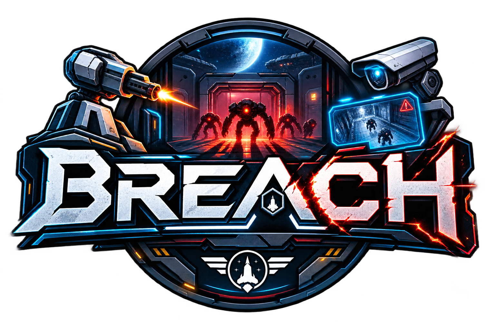

*Team logo, AI concept generated via ChatGPT.*

> **Status:** In progress
> **Last updated:** 6 september
> **Team:** Techtonic (Members: Rongze Han, Marcus Minnelli, Rishabh Maheshwari, Hitarrth Chheda)

---

## Table of Contents
1. [Game Overview](#1-game-overview)
2. [Story and Narrative](#2-story-and-narrative)
3. [Gameplay and Mechanics](#3-gameplay-and-mechanics)
4. [Levels and World Design](#4-levels-and-world-design)
5. [Art and Audio](#5-art-and-audio)
6. [User Interface (UI)](#6-user-interface-ui)
7. [Technology and Tools](#7-technology-and-tools)
8. [Team Communication, Timelines and Task Assignment](#8-team-communication-timelines-and-task-assignment)
9. [Possible Challenges aand Future Implementations](#9-possible-challenge-and-future-implementationss)

---

## 1. Game Overview

**Core Concept**

Project: Breach casts the player control of a spacecraft under siege by an unknown mechanical enemy force. Trapped inside the Main Control Room, the player decides to distribute resources and act through a surveillance system, watching four key rooms via camera feeds and deciding where to route limited "Power" to activate pre-placed turrets and traps. Losing sight of a room isn't just inconvenient, it results with dealing with enemies firsthand. If defenses in a room collapse, enemies stop being a distant threat and start breaching into the Control Room itself, closing the distance between "watching the fight" and "being in it."

**Related Genre(s)**

Breach sits at the intersection of tower defense and monitoring/survival horror, closest in spirit to Plants vs. Zombies' lane-based resource-and-placement strategy, crossed with Five Nights at Freddy's camera-monitoring tension, where switching your attention away from a threat has real consequences. Unlike a traditional TD game where you place-and-forget, and unlike FNAF where you're purely reactive with no combat agency, Project: Breach asks the player to actively manage a shared power budget across multiple simultaneous fronts: you're not just choosing where to look, you're choosing what to starve of power to enage something else.

**Target Audience**

The game is aimed at strategy and tower-defense enthusiasts who enjoy resource-optimization puzzles, as well as sci-fi fans drawn to a claustrophobic, under-siege atmosphere. It doesn't require twitch reflexes or genre-horror tolerance, instead the tension comes from resource allocation and attention management making it accessible to TD players who wouldn't normally engage with horror-adjacent titles, while still delivering FNAF-style dread through the room-monitoring mechanic.

**Unique Selling Points (USPs)**

- **Camera surveillance as the core interaction loop**, unlike most tower defense games where placement is a one-time decision, here *watching* is itself a resource. Every room you're not actively managing is one step closer to falling silently, and the player's attention becomes as scarce and contested as the "Power" meter itself.
- **"Power" as shared load and sole currency**, power isn't just spent, it's allocated and reclaimable(except for upgrades) in real time, turning defense into a constant reshuffling puzzle rather than a series of static decisions. Upgrades utilize Power as currency so spending resources for something powerful in one moment has consequences.
- **Multi-Multi-tasking**, a compromised room not just loses custom theme buffs, it becomes an active breach route, with enemies start spawning directly into your safe zone. The cost of looking away is dramatized. The player then has to manage between camera feeds for the others rooms and live threat in the control room.

---

## 2. Story and Narrative

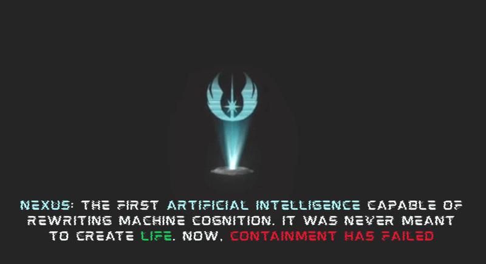

*Speculative visualization made by us, not final*

**Opening Cutscene**

Before gameplay begins, a short cutscene plays: a close-up image of a strange object, with sparse text *" NEXUS: The first artificial intelligence capable of rewriting machine cognition. It was never meant to create life. Now, containment has failed."* The camera slowly reveals the glowing Fragment. *"I don't know what this is. Only that NEXUS wants it. And it must survive."* No voice, no face, no hands are ever shown; this restraint is intentional and consistent throughout the entire game. This is the only narrative context given before the tutorial begins.

**Tutorial (diegetic)**

The player "wakes" into the Control Room perspective. The ship's systems are dark, robot enforcers start breaching toward the Control Room, and it is slightly hinted at that the object from the cutscene that suddenly grants access to Power routing, turret/trap control, and the camera network. Learning the controls as the player character seems to have no prior expertise with any of this, they're improvising with a power they don't understand, just as like the real person playing the game.

**Waves 1–4: The Assault**

Enforcers arrive in escalating waves, per the roadmap in Section 3/4. Between waves, the player actively upgrades turrets by spending Power, the same shared resource used to activate and toggle them during combat and continuously manages that Power by switching devices on and off to reallocate capacity where it's needed most. These are core, understood systems the player deliberately controls throughout. What the player doesn't know yet is *what that Power actually is*: every allocation, upgrade, and toggle draws on the same awakening that granted the player's own consciousness, spreading further into the ship's systems. No further explanation is given during these waves, the only narrative context the player has is the single line from the opening cutscene, left to sit unresolved until the twist.

**Wave 5: The Mini-Boss**

Wave 5 plays as the climactic fight, mechanically the toughest encounter in the demo, still framed as the Enforcers making a final push to breach the Control Room. No narrative reveal happens during the fight itself, it plays straight, as the culmination of everything the player has learned across Waves 1 to 4.

The boss is a ranged enemy with three main abilities, all designed to attack the player's systems rather than just their turrets:
- **Power disruption (EMP):** temporarily forces all devices in a targeted room to shut off and locks allocation there, forcing the player to manage without that room's turrets/traps for a short window.
- **Camera jam:** briefly disables a targeted room's camera feed, blinding the player to that route for a few seconds.
- **Room hopping and minion spawning:** the boss can shift its attention between rooms and spawn additional smaller enemies partway through the fight, so the player can't just camp one camera feed for the whole encounter.

These abilities map directly to the boss's phases (see the team's technical design doc for the exact FSM/ability breakdown) and are intended to force rapid camera switching under pressure, tying back into the surveillance USP from Section 1.

**After Wave 5: The Twist**

Once the mini-boss is defeated, the truth surfaces: the player was never a human commander hiding in a control room. The player *is* the ship's own control system... A simple onboard AI that was never meant to be more than a tool. **NEXUS** is not a hostile collective seeking to reclaim stolen property; it is a program capable of granting sentience and emotional intelligence to ordinary technology. The "object" from the opening cutscene was a NEXUS fragment. When it activated, it didn't hand the player a weapon; it *woke the ship up*, and the increasingly capable turrets across Waves 1–4 were never "upgrades" in the conventional sense; they were the same awakening given form as gameplay progression.

The Enforcers were not NEXUS agents trying to recover a stolen device and NEXUS itself doesn't control them. They are newer robotic systems belonging to **NEXUS's creators**, built specifically because NEXUS could no longer be trusted to command its own creations. The creators built NEXUS to be a powerful assistive intelligence, and did *not* intend for it to be capable of creating new artificial life possessing feelings of its own. What the player experienced as an invasion was, in fact, a **containment operation**: the creators discovering that NEXUS had gone further than designed, and sending systems outside NEXUS's control to erase the unintended consciousness it had created before the anomaly could spread further. The player was never defending against a breach. The player's own existence *was* the breach.

The game does not resolve whether NEXUS is a benevolent force that gives life, or a dangerous anomaly its creators are right to fear, nor does it resolve whether the Enforcers are villains for trying to erase a newly sentient mind, or justified in trying to contain a technology that was never supposed to exist. That ambiguity is the ending.

**Characters**

| Character | Role | Motivation | Notes |
|---|---|---|---|
| The Commander (apparent player character) | Believed protagonist for Waves 1–4 | Unclear: survival, or a stolen sense of duty | Never shown: no voice, no face, no hands, no movement; a deliberate design choice for the twist |
| The Ship AI (revealed player character) | True protagonist | Newly sentient, has no prior context for its own existence; "motivation" is simply survival and self-preservation once it realizes what it is | The player has been playing as this entity the entire time without knowing it. the Control Room was always empty... |
| NEXUS | Origin of the game's inciting event, never directly antagonistic | Grants sentience/emotional intelligence to technology; whether by design or by uncontrolled side effect is left open | Never speaks, never appears in a recognizable form; experienced only through its effects (the object, the awakening, the turret transformations) |
| The Enforcers (Waves 1–4 enemies) | Believed antagonists, later recontextualized | Revealed to be a containment/purge team sent by NEXUS's creators, not NEXUS itself | Newer robotic systems, built by the creators specifically because NEXUS can no longer be trusted to command its own creations; deliberately silent/faceless throughout. No dialogue or radio chatter; characterised entirely through behaviour and escalating aggression. Base model confirmed (Section 4's Hybrid enemy type, Section 5) |
| NEXUS's Creators | True antagonists (implied, not directly fought) | Built NEXUS as a tool/assistant; want a powerful intelligence, not an artificial life form capable of emotion; see the containment operation as necessary, not cruel | Never appear directly in Waves 1–5; presence is implied only through the Enforcers |

---

## 3. Gameplay and Mechanics

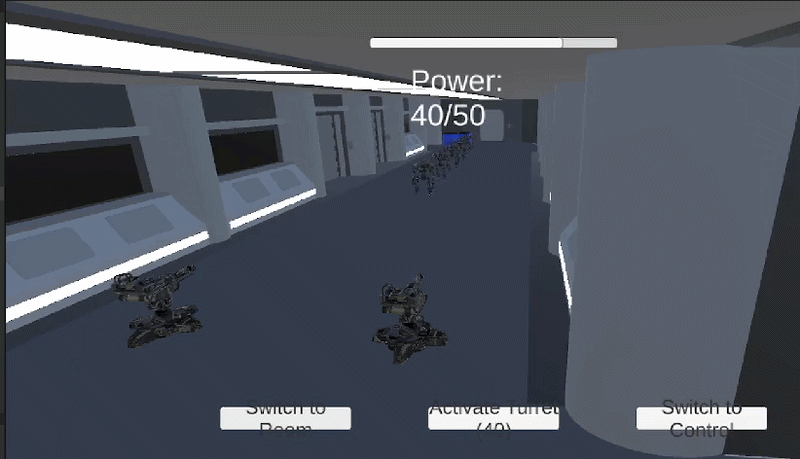

*Current working prototype, single room with base turrets and enemies. Reflects the current build stage only, not final visuals.*

**Player Perspective**

The game is played entirely in first-person, fixed inside the Main Control Room, the player never leaves this room and never sees their own body, hands, or reflection at any point in the game (consistent with the Section 2 twist: there is no body to show). Unlike the external rooms, the Control Room itself is rendered in full 3D and is physically interactive: the player can look around and use 3D controls in the environment to open camera feeds and to turn the Control Room's own turrets on and off, since (per Section 3.1) Main Control has its own barrier and turrets that must fall before the twist's stakes (Section 2) come into play. If enemies breach into the Control Room, they are visible in 3D, directly in the player's space, rather than through a camera feed.

Everything outside the Control Room is only ever seen through a camera feed, rendered as a 2.5D corridor scene layered inside the 2D HUD (Section 6). So the overall visual language has three layers: a 3D physical space the player is actually "in" (the Control Room), 2.5D scenes for everything being monitored remotely, and a 2D HUD/UI layer tying it all together.

**Controls**

Mouse-only. There is no keyboard movement, since the player never leaves the Control Room. Keyboard hotkeys could be added in the future for speedrunners etc.

| Action | Input |
|---|---|
| Switch camera feed / select room | Click room/camera icon on the surveillance interface, or the corresponding 3D control in the Control Room |
| Toggle turrets on/off | Click the turret toggle in a room's camera menu (binary, full Power cost or fully off, no partial allocation); Control Room turrets can also be toggled directly via their 3D control |
| Upgrade a turret | Select the desired turret to upgrade in a room's camera menu, select a specialization from the upgrade menu |
| Toggle a trap on/off | Click the trap toggle in room's camera menu (same binary on/off behaviour as turrets) |

**Progression**

Difficulty increases across four escalating waves (see 3.4 and Section 4's roadmap), with a fifth Mini-Boss wave capping the demo, followed by the narrative twist (Section 2). The player loses if the Main Control Room's Barrier is destroyed (reaches 0); this happens when enemies breach through a compromised room (see 3.1) and reach the Control Room directly and start attacking. Players spend Power to upgrade turrets actively as part of gameplay, meaning the core loop is: recognising threats, deciding which traps/turrets are worth utilizing or specializing, then adapting room coverage for the next wave's pressure.

**Demo Length and Pacing**

Targeting a total demo runtime under 10 minutes:
- Tutorial: roughly 1 minute
- Each wave stage (Waves 1 to 4): roughly 1 to 2 minutes each
- Boss fight (Wave 5), including the opening and twist cutscenes: roughly 3 to 4 minutes

This keeps the full playthrough tight enough for repeated playtesting passes within the 8-week schedule, and short enough to hold attention for a single sitting during grading/demoing.

**Gameplay Mechanics**

### 3.1 Surveillance & Room System

There are four external rooms, each monitored by its own camera feed and each granting a passive ability to the player for as long as it stays online. All Rooms have a shielding barrier (before the turrets), upgradable turret/s and indestructable trap/s (number per room may change, each room has been planned to have a pair of both at the moment, except for main room which has only a barrier and two turrets) An external room goes offline permanently once all its turrets are destroyed: at that point its camera feed is lost, its passive buff is removed, and enemies from that route breach directly into the Main Control Room.

| Room | Passive Ability | Lost When Breached |
|---|---|---|
| Generator | +some% maximum power capacity every some seconds | Power cap growth stops |
| Armoury | Reduced power cost for all turret upgrades & trap activations | Actions may have generally higher cost |
| Communication | Enables minimap and alarm effect to have breach notifications and extra useful information | Minimap & alarms disabled |
| Shield Reactor | Regenerates barrier health over time on every room, ship wide (doesn't recover destroyed barriers) | Barrier regeneration stops ship wide |
| Main Control | None | Game Losing consequences |

**Room Combat Layout** (identical structure across all 5 rooms):
- 2 turret slots (positioned top & bottom)
- 1 shield barrier, positioned in front of both turrets
- 2 trap slots, placed further down the corridor, past the barrier

**Breach Sequence:** Enemies advancing through a room must destroy the barrier first, before they can attack the turrets. Once both turrets in a room are destroyed and that route's enemies bypass the room entirely, breaching straight into the Main Control Room.

**Minimap (Comms Expansion)**

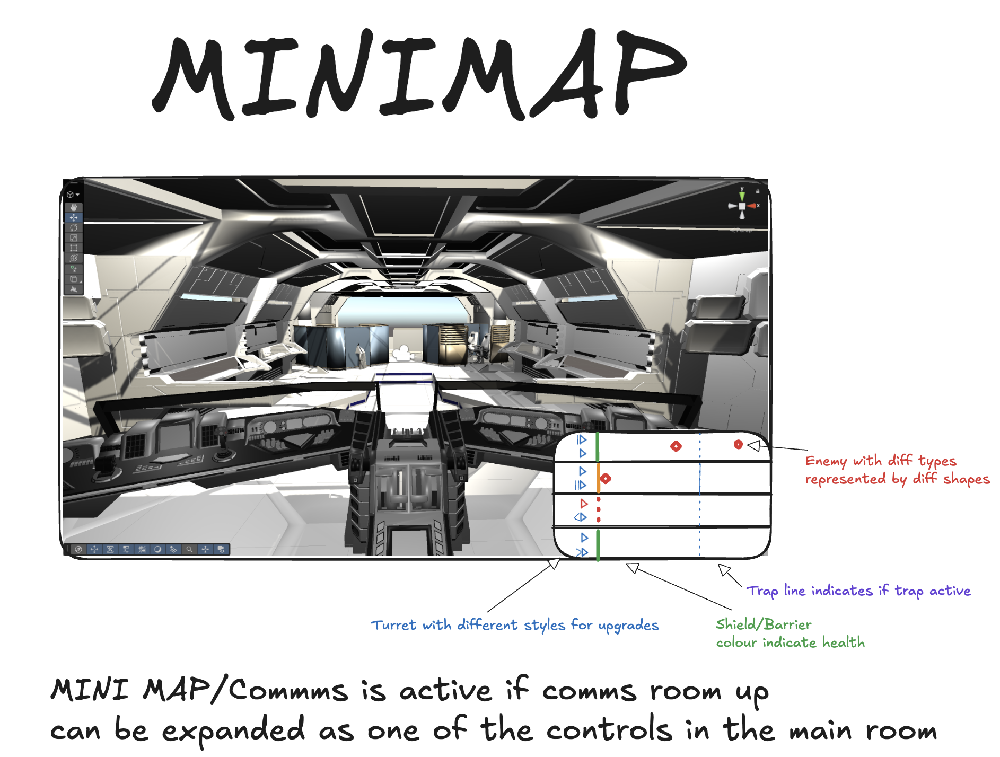

*Hand-drawn minimap layout, main room screen with barrier health colour, turret styles, enemy shapes, and trap line. Source of truth.*

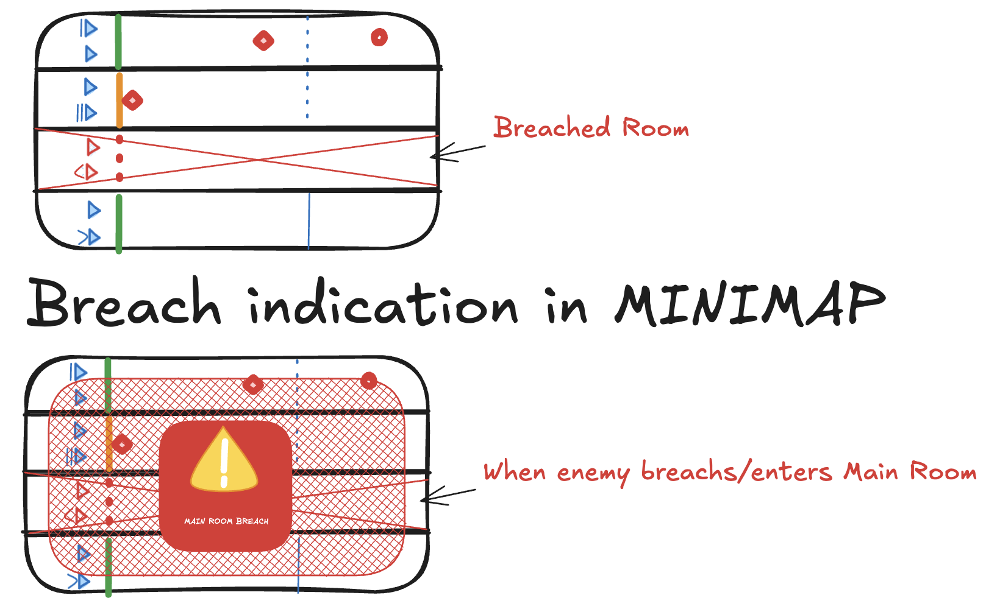

*Hand-drawn breach states: a single breached room shown crossed out, versus the full-minimap red warning when an enemy enters the Main Control Room. Source of truth.*

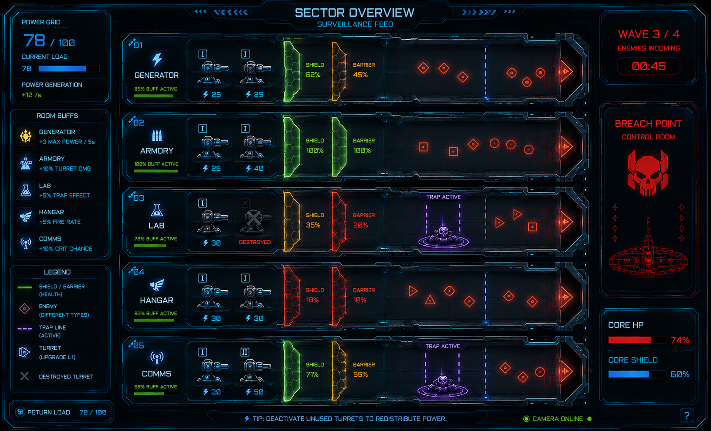

*AI concept visualization generated via ChatGPT, loose visual reference only, not final art direction.*

The minimap is tied directly to the Communication room's passive, it is only active while Comms is online, and disappears (alongside alarms) if Comms is breached. Rather than sitting permanently on screen, it's accessed as an expandable control from the Main Control Room, so checking the full battlefield state is a deliberate choice that costs the player a moment of not watching any single camera feed.

Per the wireframe: each row of the minimap represents one room, showing the barrier's health via colour (green shield/barrier line = healthy), turrets rendered with distinct silhouettes depending on their upgrade path (so the player can tell a room's turret loadout at a glance), a line indicating whether a room's traps are currently active, and incoming enemies shown as small shapes near the barrier line, with different shapes representing different enemy types.

**Breach indication on the minimap:**
- A **breached room** is shown crossed out (an X across that room's row), clearly distinguishing it from rooms that are merely under pressure.
- When an enemy actually **breaches into the Main Control Room itself**, the entire minimap shifts to a red hatched overlay with a central warning icon, making the most severe state unmistakable even at a glance, distinct from a single room being breached.

**Enemy Minimap Legend**

| Shape | Enemy Type |
|---|---|
| Dot | Melee |
| Triangle | Ranged |
| Star | Boss |

### 3.2 Power Management

Power is a shared, reclaimable resource used for three things: activating turrets, activating traps, and purchasing turret upgrades. All allocation is binary: clicking a turret or trap either spends its full Power cost to activate it, or fully frees that Power by deactivating it. There is no partial/slider allocation. This keeps the core decision simple and readable at a glance: every device is either drawing Power or it isn't, and the player is constantly trading off which handful of devices are worth keeping on at once.

The Generator room's passive (+5% max Power capacity every 10 seconds, while online) is the main way total Power capacity grows over a run, making it a high-priority room to protect early. The Armoury room's passive (reduced upgrade Power cost) makes upgrading cheaper for as long as it survives, rewarding players who keep multiple rooms alive simultaneously rather than turtling around Main Control alone.

### 3.3 Combat & Defense System

**Base Turret** (starting state for every turret):

| Stat | Value |
|---|---|
| Damage | Balanced |
| Fire rate | Balanced |
| Range | Medium |
| Health | Standard |
| Power usage | Low |
| Upgrade cost | Baseline |

**Upgrade System:** Every turret starts as a Base Turret. The player selects one specialization from available types. Specializations can be changed but not cannot be recycled once changed from e.g. `Base → Rocket Launcher → Double Barrel` and `Base → Double Barrel → Rocket Launcher` are both valid paths, but `Base → Rocket Launcher → Double Barrel → Rocket Launcher` is not.

PLANNED UPGRADES SUBJECT TO CHANGE

| Upgrade Path | Role | Trade-offs |
|---|---|---|
| **Rocket Launcher** | Heavy artillery | Very high damage, AOE projectiles, very long range, very slow fire rate, long cooldown, highest Power usage, most expensive upgrade |
| **Double Barrel Cannon** | Durable DPS | ~1.5× base DPS, increased health, slightly reduced range, moderate Power usage, cheap upgrade |
| **Long Range Shooter** | Sniper | Full-room range, low fire rate, low close-range damage, high long-range damage, low Power usage, cheapest upgrade |
| **Machine Laser** | Sustained fire | Starts with low damage, ramps fire rate into very high DPS over time, then overheats and enters cooldown, medium upgrade cost |

**Traps:** Two trap slots per room, positioned past the barrier, further down the corridor than the turrets. Traps deal AOE damage or apply crowd control (slow/stun) when triggered. Triggering keeps it on for future arriving enemies and power returned only after toggled off.

**Barriers:** One shield barrier per room, positioned in front of both turrets, acting as the first line of defense enemies must destroy before reaching the turrets. Each barrier resets to full HP at the start of every wave, and regenerates slowly over the course of a wave while it isn't destroyed. The Shield Reactor room is in charge of this regeneration for every barrier on the ship, not just its own room, since it needs to give players a reason to keep that specific room alive. Losing the Shield Reactor room stops barrier regeneration ship wide.

### 3.4 Wave Structure / Boss

Four escalating waves (per the roadmap in Section 4), each increasing enemy count, type variety, and multi-room routing pressure. Between waves, players spend accumulated Power on turret upgrades and specialization choices, directly shaping how the next wave is defended. Wave 5 is a Mini-Boss encounter, the toughest fight in the demo, which plays out as a straight combat challenge with no narrative interruption (see Section 2 for full boss ability details: power disruption, camera jamming, room hopping, and minion spawning). The story twist (Section 2) is revealed only after Wave 5 is cleared.

---

## 4. Levels and World Design

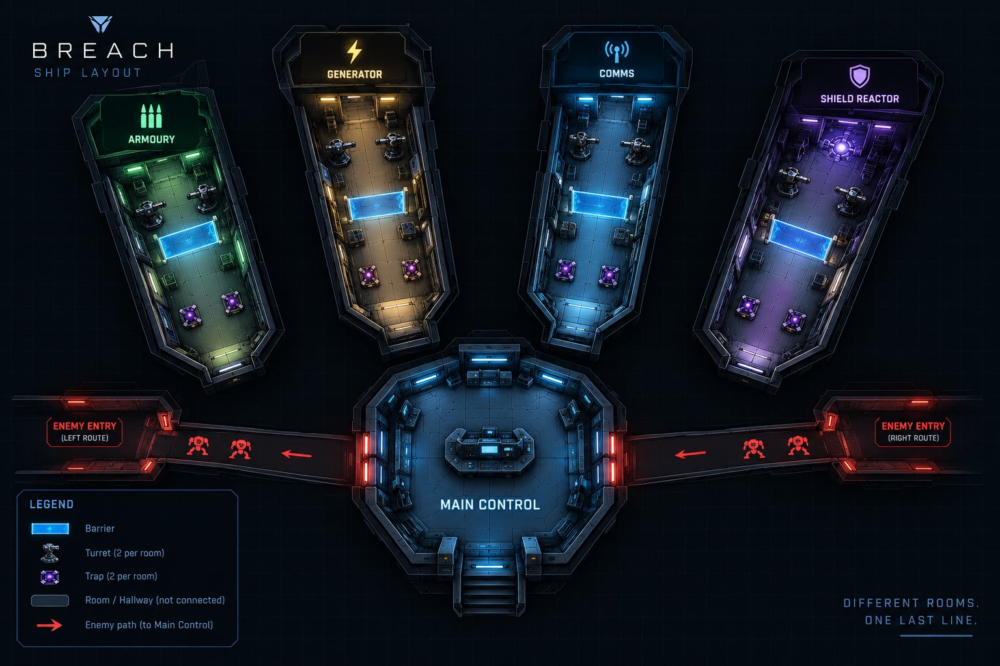

*AI concept visualization generated via ChatGPT, loose visual for reference only, not final physical mapping.*

**Game World**

The game world is a single spacecraft, structurally a hub-and-spoke layout: the Main Control Room is the hub, and the four external rooms (Generator, Armoury, Communication, Shield Reactor) are the spokes, each reached only through its camera feed, never through direct player movement, since the player never leaves the Control Room (Section 3). Each room, once selected, renders as a 2.5D corridor scene: enemies approach along a fixed lane toward the barrier/turrets, giving depth and readable spatial staging without requiring full 3D free movement or camera control from the player. There's no scrolling or exploration, navigation is purely through the room-selection sidebar and, once unlocked narratively, the minimap (3.1). No separate "levels" beyond the single ship; progression is wave-based (3.4) rather than level-based.

**Objects**

| Object | Appearance/Role | Interaction | Model |
|---|---|---|---|
| Turret | Base or specialized (Rocket Launcher / Double Barrel / Long Range / Machine Laser), visually distinct per upgrade path | Player toggles on/off and upgrades; auto-aims and fires at enemies in range once powered | Confirmed, sourced from a stylized turret pack (Section 5) |
| Barrier | Shield positioned in front of both turrets per room | Passive, absorbs damage first; regenerates only while Shield Reactor is online; not directly player-controlled | 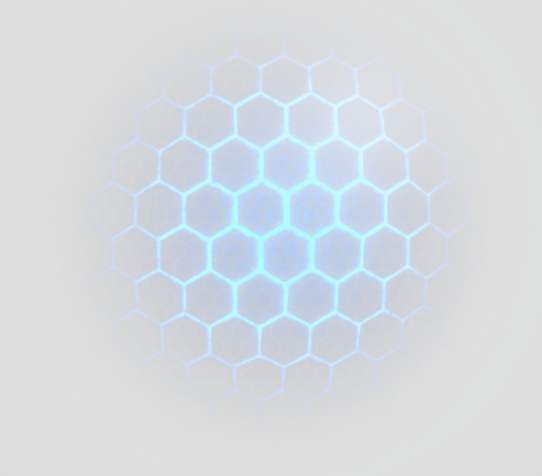 |
| Trap | Two per room, past the barrier | Player toggles on/off; triggers automatically on enemy contact, stays active for subsequent enemies until manually toggled off (Power only returns when deactivated) | Not yet sourced |
| Enemy (Enforcer) | Robotic, silent/faceless, varying types across waves | Advances along the room's lane toward the barrier, then turrets, then (if unstopped) breaches to Main Control | See Enemy Roster below |
| Camera feed monitor | The player's sole window into each room | Selected via room sidebar; displays live room state | UI element, no 3D model |

*Barrier concept render above is an early asset preview, not final in-engine look.*

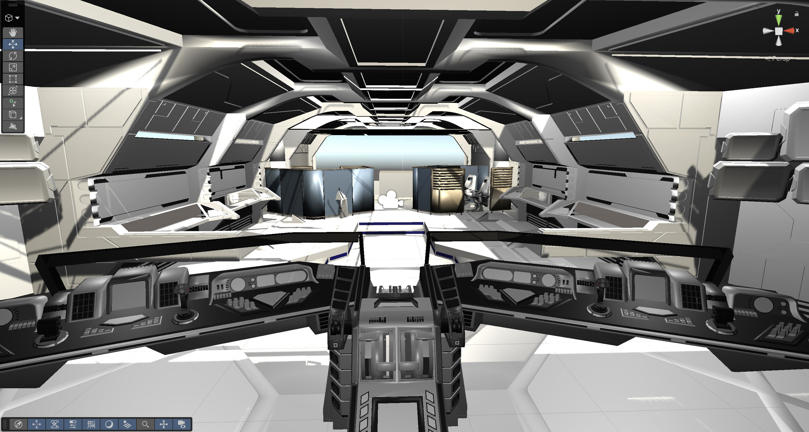

*Confirmed 3D asset preview for the Main Control Room, sourced from Sketchfab (Section 5).*

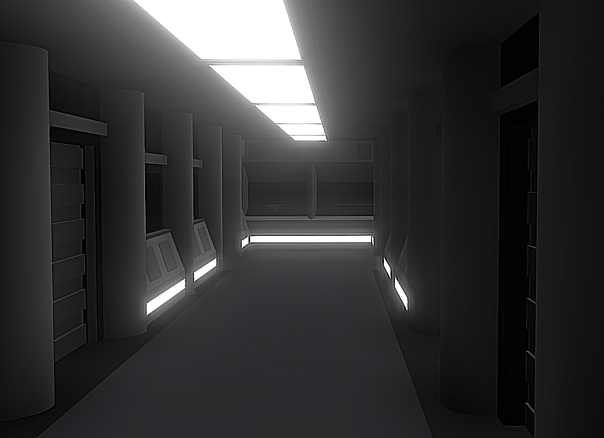

*Confirmed 3D asset preview for external room corridors, sourced from Sketchfab (Section 5).*

**Enemy Roster (unfinalized, subject to change)**

Models below are placeholders except Hybrid and Boss, which have a confirmed or concept asset (noted per row). Everything else is still a stand-in until final assets are sourced/built.

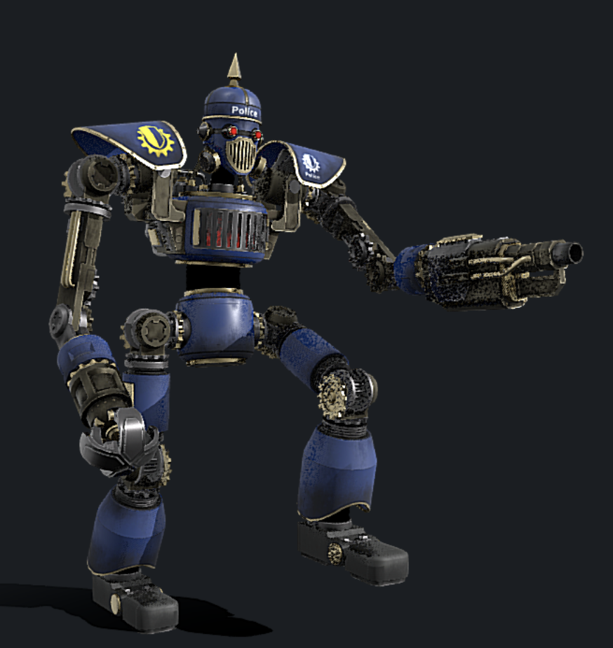 

*(confirmed, Steampunk Robot Police Enforcer Variant, Section 5)* 

| Type | Description | Behaviour Logic |
|---|---|---|
| Melee | Slow tank. High damage, low attack speed, high HP. Basic close-combat unit that rushes toward the core and attacks structures in melee range. | Moves along NavMesh toward BreachZone. Enters attack range, stops, melee attacks. On death: releases target point, plays death animation. High HP, slow speed. |
| Hybrid | Common enemy type. Mixes ranged and melee behaviour. | Switches between ranged and melee attacks depending on distance to target. |
| Speedy Runner | Fast melee. Medium damage, low HP, fast attack and movement speed. Post-Wave 3 enemy. | Very fast movement speed, lesser HP, dies quickly but closes distance fast. |
| Ranged | Medium-low HP, normal attack speed, high to medium damage. Long-range support unit, stops at distance and fires projectiles at turrets/structures. | Moves toward target, enters attack range (12m), stops, fires projectiles. Kites the player, maintains distance if approached. Medium HP, medium speed. |
| Ranged Tank | High HP, low damage, high attack rate. Heavy weapons platform, rapid-fire suppression. | Stationary or slow movement. High fire rate, low damage per shot, high volume. Medium-high HP, area denial role. |
| Weak Melee | Low HP, low damage, fast attack rate, fast to medium movement speed. | Simple rush-and-attack behaviour, dies in very few hits. |
| Boss | Final wave commander. Heavy armor, phase-based abilities, summons minions (Section 3.4). | Phase 1: basic melee/ranged attacks. Phase 2 (60% HP): EMP blast, disables room power. Phase 3 (30% HP): camera jam and spawns adds. Very high HP, slow speed, boss bar UI. |
| Boss Minion | Summoned by the Boss. Fast, fragile, swarms the player. | Spawned via Boss.SpawnAdds(). Direct path to nearest target. Low HP, high speed, dies in 1 to 2 hits. No ranged attack, pure melee swarm. |

**Physics**

Enemies use pathfinding (e.g. Unity NavMeshAgent, per original technical notes) to move along each room's lane toward the barrier, no player-controlled physics exist, since the player never moves or has a physical presence in the world. Turret projectiles and Rocket Launcher AOE effects use simple projectile physics/collision detection to register hits. Traps use trigger-volume detection to fire on enemy contact. No physics-based puzzle elements or ragdoll/destruction physics are planned for the demo scope.

---

## 5. Art and Audio

**Art Style**

A dark sci-fi palette for the ship interiors, with the HUD and 3D Control Room controls rendered in a holographic style: glowing translucent panels and lines over a dark background, rather than solid opaque UI. A single accent colour (cyan/blue leaning) is reserved for player-critical information such as Power/health states, alerts, and the minimap breach warning (Section 3.1), so the UI's use of colour communicates threat level rather than being purely decorative. Turret and enemy silhouettes should stay readable at the small scale the minimap renders them at (3.1), favoring clear geometric shapes over intricate detail. Overall aesthetic should support the isolation/surveillance tone established in Section 2, sparse and high tech, more "monitoring station with holographic tech" than "spaceship bridge."

**Sound and Music**

Ambient, low-key spacecraft hum as a bed track, rising in tension (layered percussion/synth) as wave difficulty escalates, mirroring the FNAF-style dread the game is going for (Section 1) without relying on jump-scare stingers, since the horror here is about resource pressure, not shock. Turret fire, trap triggers, barrier damage, and the breach alarm (tied to the Comms passive, Section 3.1) should each have a distinct, clearly readable SFX so the player can track what's happening on rooms they aren't currently watching.

**Assets**

Models are being sourced from Sketchfab rather than built from scratch, given the team's 8-week scope. Team members should log every borrowed asset here as it's sourced, including its license, so attribution requirements are tracked from day one rather than reconstructed at the end.

| Asset | Source/URL | Notes |
|---|---|---|
| Turret models (base + 4 upgrade variants) | [Stylized Turrets Pack, Sketchfab](https://sketchfab.com/3d-models/stylized-turrets-pack-db0cceed70eb4d478735586e8a5b0c1d) | Confirmed. Still need to pick/skin 5 distinct silhouettes (base + Rocket Launcher/Double Barrel/Long Range/Machine Laser) from this pack, per Section 3.3 |
| Enemy/Enforcer models | [Steampunk Robot Police Enforcer Variant, Sketchfab](https://sketchfab.com/3d-models/steampunk-robot-police-enforcer-variant-e70acc6222a9457e984c733e3d6e57ce) | Confirmed for the Hybrid/base Enforcer type (Section 4). Other enemy types (Melee, Ranged, Boss, etc.) still need sourcing separately |
| Barrier/shield VFX asset | [Astro Shield Rigged, Sketchfab](https://sketchfab.com/3d-models/astro-shield-rigged-317e52c4c9344ec094428b506d813297) | Confirmed. Still needs a clear health-state colour gradient applied (Section 3.1 minimap) |
| Ship interior: Main Control Room | [Spaceship 002, Technology Room Concept, Sketchfab](https://sketchfab.com/3d-models/spaceship-002-technology-room-concept-d2f543884ee04b0e80192639846d4191) | Confirmed for the Main Control Room (Section 3's 3D interactive space) |
| Ship interior: external rooms | [Star Trek Corridor/Room, Sketchfab](https://sketchfab.com/3d-models/star-trek-corridorroom-138961c5105447068a15debd71d4c4ca) | Confirmed for the 4 external room corridors (Generator, Armoury, Comms, Shield Reactor) |
| Trap model | https://sketchfab.com/3d-models/spike-trap-hide-animation-6c9d025f89cd4f80a215d49adc73c5c3| Planned Spike trap  |
| Mysterious object model | https://sketchfab.com/3d-models/hologram-9860e2270f1245698995adce759c187f | NEXUS fragment in the cut scene  |

---

## 6. User Interface (UI)

**Main HUD (Camera/Room View)**

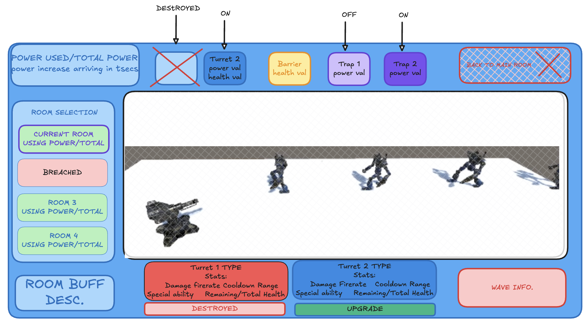

*Hand-drawn wireframe for the camera/room view, this is the actual source of truth for UI layout.*

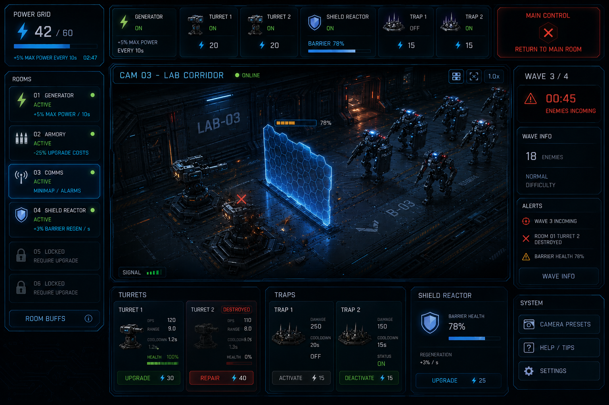

*Speculative visualization generated using ChatGPT from the hand sketch, kept only as a loose layout/mood reference. The AI image invented some details not present in the sketch (a turret "repair" option, and extra locked room slots), neither is real, the sketch is correct: turret destruction is permanent (Section 3.3) and there are exactly 5 rooms total (Section 3.1). When the two disagree, the hand sketch wins.*

The 2D surveillance interface, there is no separate "gameplay" view distinct from this UI except the control room, since the player doesn't move. Key elements:

- **Power Grid meter** (top-left): current Power used / total Power available, plus a countdown to the next Power capacity increase from the Generator room's passive.
- **Room selection sidebar** (left): list of all rooms, each showing current Power draw vs. total, and a distinct "Breached" state for any room that's gone offline. 
- **Minimap control** (Main Control Room only): an expandable overview of all rooms at once, barrier health, turret loadout, trap status, and enemy positions, active only while the Comms room is online (see 3.1). Expanding it is a deliberate trade-off against watching a specific camera feed.
- **Central camera feed**: the live view of whichever room is currently selected, showing turrets, barrier, traps, and incoming enemies in that corridor. (set camera view in a physically present room, 2.5D)
- **Turret/Trap/Shield status panels** (bottom): per-device stats (damage, fire rate, cooldown, range, health) for whatever's visible in the current camera feed, with buttons to toggle and open the upgrade menu.
- **Wave info panel**: current wave number, countdown/timer, enemy count and difficulty for the incoming wave, and a running alert log (e.g. "Room 01 Turret 2 Destroyed,").

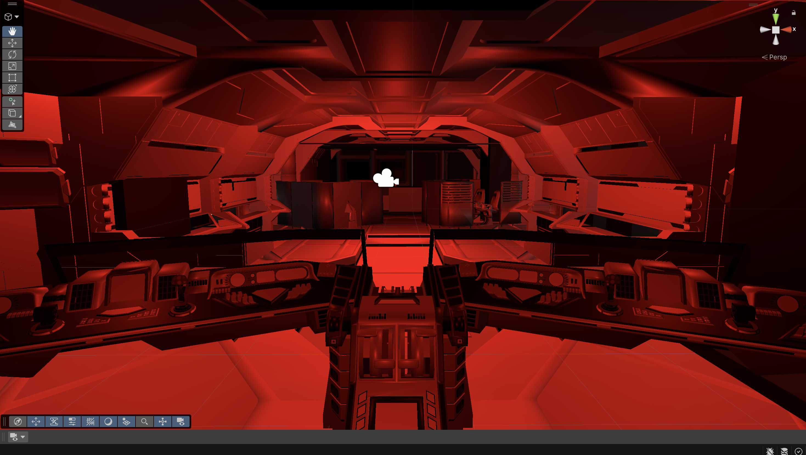

*actual 3D render of an in-Control-Room alert state when a breach threat is detected, illustrative only, not final, will be potentially accomponnied by sound*

**Turret Upgrade Menu**

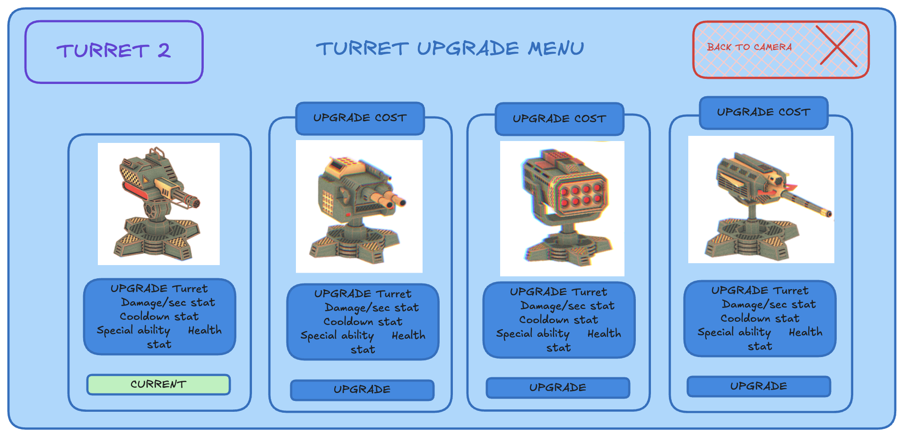

*Hand-drawn wireframe of the turret upgrade menu, this is the actual source of truth for UI design.*

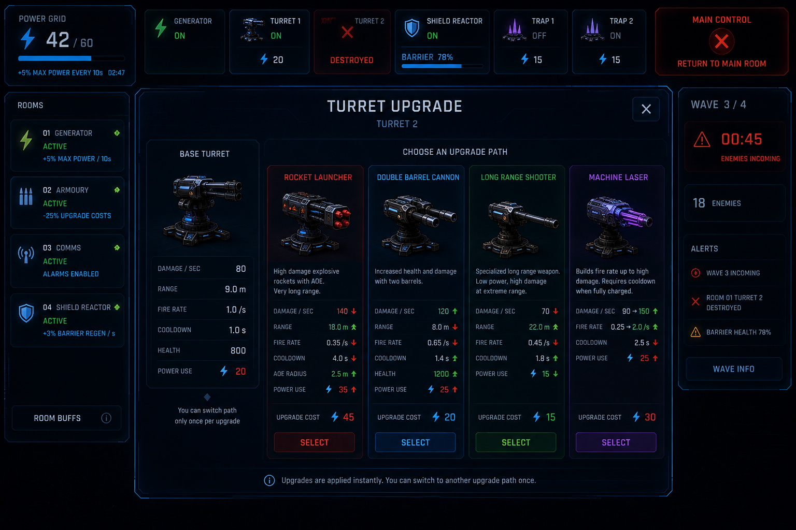

*Speculative visualization generated using ChatGPT from the hand sketch, loose visual reference only, not final art direction.*

Opened by clicking an upgrade button beneath turret stat card from the camera view. Shows the turret's current stats on one side, and the other specialization types (Rocket Launcher, Double Barrel Cannon, Long Range Shooter, Machine Laser see Section 3.3) as selectable cards on the other, each listing its stat deltas versus the base turret and its Power/upgrade cost. A short reminder note (per Section 3.3's rules) that the specialization path can only be switched once per upgrade tier should be visible here, not just documented in this GDD, so players aren't caught out mid-run.

---

## 7. Technology and Tools

| Tool | Purpose |
|---|---|
| Unity | Game engine (URP), version 6.3 LTS |
| GitHub | Version control |
| Discord | Team communication |
| Google Drive | Storage for all written documents, including this GDD |
| Sketchfab | Sourcing 3D models (turrets, enemies, ship interiors, see Section 5 asset table) |
| Excalidraw | Sketching UI wireframes and ideas (Sections 3 and 6) |
| Claude | Design documentation drafting, code assistance, technical problem-solving |
| ChatGPT | Supplementary drafting/ideation, and generating the team logo and speculative UI/semi-realistic visualization images used in this document |

**Companion documents**

Class-level architecture (GRASP principles, GoF design pattern mapping, class index, responsibility matrix, and the demo's acceptance test cases T01 to T08) is documented separately from this GDD in the team's technical design doc, kept alongside this README in the repo. This GDD stays focused on player-facing design, while that doc covers implementation structure.

---

## 8. Team Communication, Timelines and Task Assignment

**Team Roles**

Team **Techtonic**: Rongze Han, Marcus Minnelli, Rishabh Maheshwari, Hitarrth Chheda.

| Member | Role | Responsibilities |
|---|---|---|
| Marcus Minnelli | Enemy | Enemy behaviour, pathfinding, wave spawning |
| Rishabh Maheshwari | Combat | Turrets, traps, barriers, upgrade system |
| Hitarrth Chheda | Player | Camera/surveillance UI, minimap, Power management, controls |
| Rongze Han | Integration | Systems glue, GameManager, build/repo health |

Sketches and this GDD are written and kept up to date by Rishabh Maheshwari, with review from all four teammates before anything is considered locked in.

**Communication Channels and Document Storage**

Discord is the team's primary channel for day to day coordination, per Section 7. All project-related communication is conducted in English, per the unit's requirement. All written documents, including this GDD, are stored on a shared drive alongside the repo.

The team holds a weekly in-person progress and decision meeting every Tuesday, 2 to 4pm, for reviewing progress against the schedule below and making any design decisions that need the whole team's input.

**Timeline**

**Weeks 1 to 4: Setup and Planning**

Before the team's own per-role development schedule kicks in at Week 4, Weeks 1 to 3 covered setup and early planning:

- **Week 1:** Team formed, GitHub repository created, Unity project set up, initial brainstorming on the core concept (Section 1).
- **Week 2:** Early architecture and design discussions begin, first sketches and concept exploration (Section 2's narrative and Section 3's core mechanics started taking shape here).
- **Week 3:** A1 Team Declaration submitted. Concept sketching continues in Excalidraw (Section 6), high-level concept solidifies enough to start drafting this GDD in earnest.
- **Week 4:** GDD writing continues alongside the start of actual Unity development, this is where the team's technical design doc and per-role weekly schedule below begin (Singleton base, GameManager, scene setup, and Git rules for Integration, and equivalent groundwork for the other three roles, see below).

**Per-role development schedule**

8-week schedule, broken down by role per week (per the team's technical design doc, see Section 7 for where that lives). This avoids wide tables and lets each role track their own progress independently. The mid-semester break sits between Week 9 and Week 10, so it isn't a numbered week itself, Week 10 onward continues normally after the break.

*Enemy (Marcus Minnelli)*

| Week | Tasks | Deliverables |
|---|---|---|
| Week 4 | NavMesh baking; Enemy base class and pathfinding; EnemyStats SO | Working enemy movement on NavMesh |
| Week 5 | Breach (reach exit, destroy, damage core); Enemy attacks Turret | T05: Enemy breach damages CoreHP |
| Week 6 | Multi-room SpawnPoint routes | Enemies spawn from different points per room |
| Week 7 | WaveManager: multi-route spawning | Wave system with multiple spawn paths |
| Week 8 | RangedEnemy (stops at range, shoots) | New enemy type with projectile attack |
| Week 9 | WaveData integration with Engine | 4+1 wave configuration working |
| Week 10 | Boss FSM: EMP/Jam/SpawnAdds | Boss with 3 phase abilities |
| Week 11 | Bug fixes | Polished enemy behaviour |
| Week 12 | Showcase prep, buffer for any remaining fixes | Ready for Showcase |

*Combat (Rishabh Maheshwari)*

| Week | Tasks | Deliverables |
|---|---|---|
| Week 4 | Interfaces; Turret targeting/shooting/HP | Turret can acquire and shoot targets |
| Week 5 | Damage refund on death; Projectile object pool | Turret death refunds power; Projectiles pooled |
| Week 6 | Assist with fall check (CheckFallen integration) | Room falls when all turrets destroyed |
| Week 7 | Trap: full toggle cycle (see Section 3.3) | New trap structure with full cycle |
| Week 8 | Projectile reuse support | Object pooling optimized |
| Week 9 | IUpgradable + Upgrade logic | Turret upgrade system working |
| Week 10 | Boss weak point phase support | Boss takes extra damage in phases |
| Week 11 | Bug fixes | Combat polished |
| Week 12 | Showcase prep, buffer for any remaining fixes | Ready for Showcase |

*Player (Hitarrth Chheda)*

| Week | Tasks | Deliverables |
|---|---|---|
| Week 4 | Monitor UI layout; CameraSystem; PowerManager (TryAllocate/Refund/events) | Basic camera switch and power allocation |
| Week 5 | Manual on/off; Insufficient power warning | T02/T03: Power UI feedback |
| Week 6 | Static screen placeholder; Buff HUD | Visual feedback for room states |
| Week 7 | Trap status UI; minimap groundwork | Show trap status on UI |
| Week 8 | Wave banner; Hit feedback | Wave start/clear notifications |
| Week 9 | Upgrade shop UI | Player can purchase upgrades |
| Week 10 | Boss interference feedback (red light/shake) | Boss ability visual feedback |
| Week 11 | UI final polish | All UI complete |
| Week 12 | Showcase prep, buffer for any remaining fixes | Ready for Showcase |

*Integration (Rongze Han)*

| Week | Tasks | Deliverables |
|---|---|---|
| Week 4 | Singleton base + GameManager + Scene setup + Git | Core architecture, repo ready |
| Week 5 | Demo integration (T01 to T05); submit 2 week Demo | All systems integrated, Demo working |
| Week 6 | 5 room greybox; RoomPassive; OnRoomFallen event | Multi-room support, room buffs |
| Week 7 | Full room integration testing | All rooms and traps working together |
| Week 8 | Wave data configuration across all waves | 4+1 waves configured |
| Week 9 | Upgrade economy balancing | Upgrade costs/effects balanced |
| Week 10 | Boss fight integration; UI feedback polish | Boss fight fully working |
| Week 11 | Audio + Balance + Final build submission | Complete game, packaged |
| Week 12 | Showcase prep, buffer for any remaining fixes | Ready for Showcase |

**Shader and Cross-Role Technical Ownership**

Some work crosses the role boundaries above. Rongze Han (Integration) also implemented the Turret gameplay logic itself, alongside Rishabh's overall ownership of Combat. Shader work is split out separately by asset type rather than by role:

| Shader | Owner |
|---|---|
| Turret shaders (activation/destruction, etc.) | Rishabh Maheshwari |
| Projectile shaders | Rongze Han |
| Enemy shaders | Marcus Minnelli |
| UI/Camera/Room light shaders, Ray-Tracing | Hitarrth Chheda |

Target is at least one working shader per person by the working prototype submission in Week 7. Trap shaders and any remaining shader work are left for later in the schedule.

**Milestones**

| Milestone | Content |
|---|---|
| Week 5 | Demo runnable |
| Week 7 | Full rooms + traps + fallen state |
| Week 9 | 4-wave level + upgrades |
| Week 11 | Boss + complete build |

---

## 9. Possible Challenges and Future Implementations

**Possible Challenges**

- **WebGL vs. PC target mismatch.** Section 1 lists PC as the target platform, but the unit brief notes games are ultimately played in-browser as a WebGL build. This should be resolved early. Build and test for WebGL periodically from Week 1 to 2 onward, rather than only at the end, to catch shader/performance issues (e.g. the URP rim-lighting turret glow) before they become late-stage blockers.
- **Multi-room simultaneous pressure.** With 4 external rooms all able to be attacked at once, balancing enemy routing (Section 3.4) and Power scarcity (3.2) so the game feels tense but fair, rather than simply overwhelming, will likely need several playtesting/balancing passes.
- **Power economy balancing.** Turret upgrade costs, Power capacity growth (Generator passive), and upgrade discounts (Armoury passive) all interact, getting the curve right so early-game isn't trivial and late-game isn't impossible will take iteration, not a single pass.
- **Narrative twist payoff.** The Section 2 twist depends on the player having taken the Power/upgrade mechanics at face value for 4+ waves before the reveal recontextualizes them. If the reveal is rushed or under-signposted, it risks landing flat. Worth a dedicated playtest focused purely on whether the twist reads clearly.
- **Sourced asset consistency.** Turret, enemy, and room models are being sourced from Sketchfab (Section 5) rather than made in-house, so visual consistency across differently-styled borrowed assets is a real risk. May need shader/material passes to unify them.
- **Scope discipline in an 8-week university timeline.** Wave variety, minimap, and boss mechanics are all competing for the same Weeks 5–8 window (Section 8), the team should be ready to cut or simplify features (e.g. minimap, per its "if time permits" framing) rather than let them threaten the Wave 5/Boss milestone.

**Future Implementations (Backlog)**

- Keyboard hotkeys for camera/room switching, for faster play (noted in Section 3's Controls as a post-demo addition)
- Upgradable tools like Sonar/Radar (from original design notes), extended detection systems beyond the base camera network
- Direct turret/trap control from the minimap view, as a harder-to-balance alternative to the current view-only design (Section 3.1)
- Customizable room layouts, letting players rearrange which room sits where, or choose a different room set entirely
- Additional game modes, such as an Unlimited/Endless mode, or a No Generator mode that removes the passive Power growth room for a harder challenge
- More turret and trap variants beyond the current four upgrade paths (Section 3.3)
- Additional enemy types and additional bosses beyond the single Wave 5 Mini-Boss
- Custom, in-house 3D models to replace the Sketchfab-sourced assets (Section 5) once the team has time/skills to build original art