# Shader Report

## Table of Contents

- [ProjectileShader - Plasma Projectile](#projectileshader---plasma-projectile)
- [HitReaction - Enemy Damage Effect](#hitreaction---enemy-damage-effect)
- [BreachRoom - Main Room Breach Effect](#breachroom---main-room-breach-effect)
- [Turret Activation System - TurretTop & TurretBase](#turret-activation-system---turrettop--turretbase)
- [Contribution Report](#contribution-report)

## ProjectileShader - Plasma Projectile

**Author:** Rongze Han

### Shader Source File

[Assets/Shaders/PlasmaProjectile.shader](./Assets/Shaders/PlasmaProjectile.shader)

### Shader Effect

This is a Plasma Projectile shader designed for the defensive turrets. The projectile renders as a semi-transparent energy ball featuring Fresnel edge lighting, a semi-transparent center, and a breathing pulse. The surface utilizes a noise-driven energy stream, while the vertex stage applies slight normal displacement to create an unstable plasma geometry. Additionally, Bloom post-processing is used to pick up the HDR colors and generate a glowing effect.

### Chosen Theme

**Theme 2 — Surface Appearance and Procedural Effects**

(Procedural noise pattern animation + transparent masking to control surface appearance; Fresnel edge lighting as support).

### Design Justification

Our game is a spaceship surveillance turret defense game where the player observes turret combat through camera feeds. The turret projectile is the most frequently seen active element in the scene, and its visual quality directly determines the futuristic feel of the combat. A glowing plasma ball is an iconic element that effectively portrays this high-energy aesthetic. The glow also ensures the projectile remains highly visible in dark corridor environments, perfectly aligning with the sci-fi setting.

### Unity Inspector Parameters

- `_Color`: HDR main color; controls the plasma color and intensity (Bloom trigger threshold).
- `_RimPower`: Rim light sharpness (higher values concentrate the glow towards the edges/silhouette of the sphere).
- `_PulseSpeed`: Breathing/pulsation frequency.
- `_GlowStrength`: Overall glow intensity.
- `_NoiseTex` / `_NoiseSpeed`: Noise texture and scrolling speed; controls surface turbulence.
- `_Wobble`: Vertex wobble/displacement amplitude (0 = perfect sphere).

### Technical Implementation

- **Vertex Stage**: Sinusoidal displacement along the normal direction, creating unstable micro-deformations of the plasma.

- **Fragment Stage**: Fresnel rim lighting (view-dependent) + time-based sinusoidal pulsation + scrolling UV noise perturbation. Ultimately, it outputs an HDR color using additive blending (`Blend SrcAlpha One`), which is picked up by the Bloom post-processing effect to generate a glow.

### Effect Screenshots

#### Vertex Wobble Comparison (`_Wobble`: 0.2 vs 0.01)

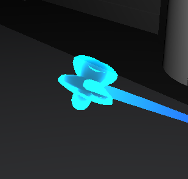

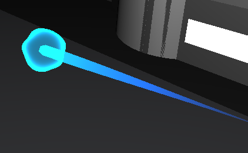

#### RimPower Comparison (**Edge Glow Sharpness**: 2.5 vs 8)

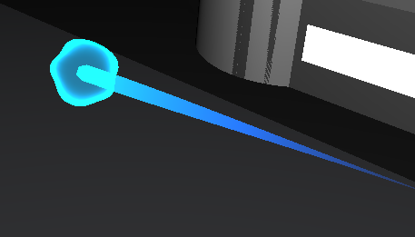

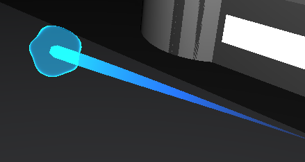

#### Glow Strength Comparison (`_GlowStrength`: 3 vs 8)

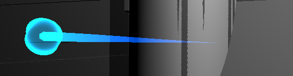

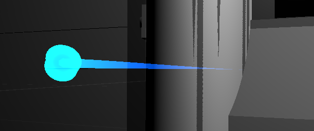

### References

- Unity Documentation: [Shader tutorial: vertex and fragment programs](https://docs.unity3d.com/Manual/ShaderTut2.html)
- Unity Documentation: [Writing vertex and fragment shaders](https://docs.unity3d.com/Manual/SL-ShaderPrograms.html)

## HitReaction - Enemy Damage Effect

**Author:** Marcus Minnelli

### Shader source:

[`Assets/Shaders/HitReaction.shader`](Assets/Shaders/HitReaction.shader)

### Shader Effect

The HitReaction vertex and fragment shader gives visual feedback when an enemy takes damage. It combines two effects driven by a `_HitTime` value, which is set once per hit via a HitReactionController script:

- **Vertex shader shake** — each vertex is displaced along its own normal by a sine wave, whose amplitude decays over time since the hit. This produces a short flinch that settles back to rest.

- **Fragment ring of light** — the fragment stage measures each pixel's world-space distance from an origin, which is set to roughly the middle of the model. It then creates a ring of light that spreads from that origin, growing over time at a configurable speed. So the effect reads as a ring of light expanding outward from the point of impact before fading and disappearing.
As well as this there is a Blinn–Phong lighting model, so the shaded enemy still looks lit correctly outside of the hit effect.

### Theme

**Theme 2 — Surface Appearance and Procedural Effects.** While the shake technically moves geometry, the effect's defining visual is the procedural and distance-based mask that produces the expanding ring. The ring is created using maths rather than pre-authored animation or texture data.

### Why This Effect Was Chosen

Enemies in the game take continuous damage from the turrets, and with no health bar or visual indicator that they were hit, it did not look like the bullets were doing anything. A shake plus an expanding ring gives an immediate signal that the enemy was hit, reinforcing player feedback loops without needing extra animations or particle effects.

### Exposed Parameters

- **`_MainTex`** — base colour texture for the surface.

- **`_Shininess`** — Blinn–Phong specular exponent, controlling highlight tightness.

- **`_HitOrigin`** — world-space offset from the character's root marking where the ring originates.

- **`_HitTime`** — internal timestamp set by script when a hit occurs.

- **`_RingSpeed`** — how fast the ring's radius expands.

- **`_RingWidth`** — thickness of the visible ring band.

- **`_RingColour`** — colour of the glow.

- **`_RingMaxRadius`** — distance at which the ring fully fades out.

- **`_ShakeAmplitude`** — maximum vertex displacement on hit.

- **`_ShakeFrequency`** — oscillation speed of the shake.

- **`_ShakeDecay`** — how quickly the shake settles back to rest.
### Screenshots

#### Enemy - no effect

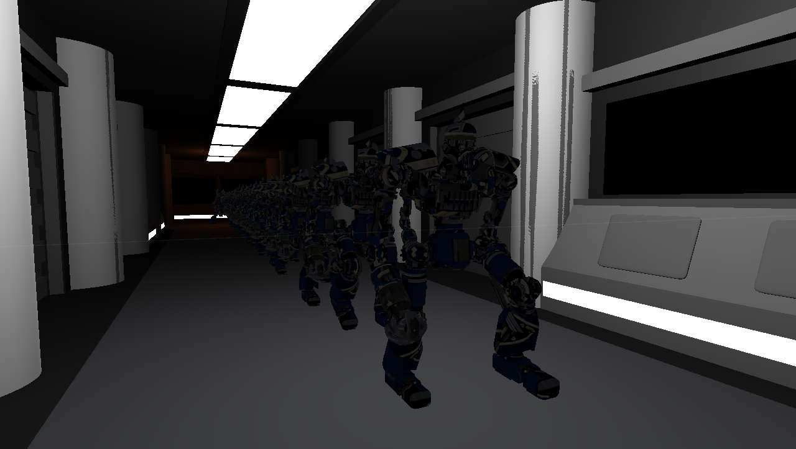

#### Enemy hit reaction (Red ring and slight shake)

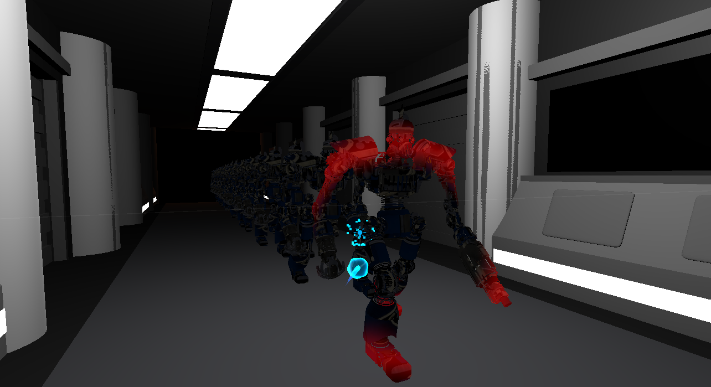

#### Enemy hit reaction (Enhanced Shake, Amplitude from 0.2 to 0.4)

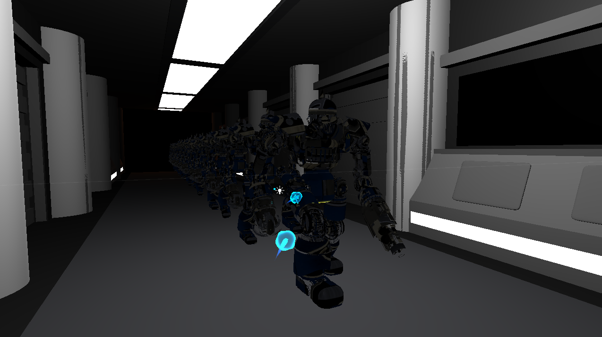

#### Enemy hit reaction (Different Ring, Colour to yellow and Width from 2 to 0.5)

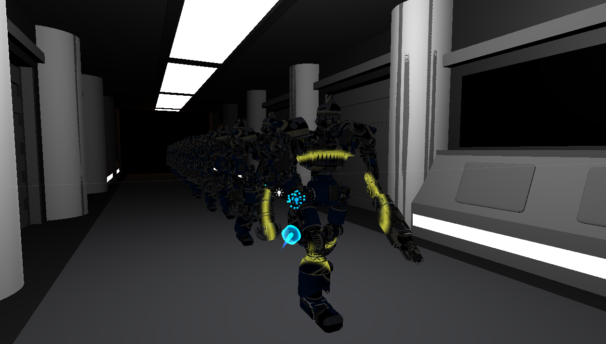

### External Resources

- Unity Documentation: [Built-in shader include files](https://docs.unity3d.com/560/Documentation/Manual/SL-BuiltinIncludes.html)
- Unity Documentation: [Custom lighting models in Surface Shaders](https://docs.unity3d.com/2023.2/Documentation/Manual/SL-SurfaceShaderLighting.html)

## BreachRoom - Main Room Breach Effect

**Author:** Hitarrth Chheda

### Shader Source File

[Assets/Shaders/BreachRoom.shader](./Assets/Shaders/BreachRoom.shader)

### Shader Effect

The BreachRoom shader is applied to the screens in the Main Control Room when an enemy breaches the room. It creates an animated emergency effect by blending the original screen texture with a configurable breach colour. A time-based pulse alternates between darker and brighter versions of the breach colour, creating a pulsing red warning.

The shader also adds procedural digital corruption. The screen is divided into horizontal sections, with pseudo-random values determining which sections are temporarily shifted horizontally. This creates an animated glitch effect that can be controlled independently from the breach colour.

### Chosen Theme

**Theme 2 — Surface Appearance and Procedural Effects**

The effect uses handwritten Cg/HLSL code to procedurally animate the screen's colour and generate digital corruption without relying on pre-authored animations.

### Design Justification

The game is a spaceship surveillance turret defense game where the player monitors different rooms. Since the Main Control Room screens are already prominent environmental elements, they provide an effective location for breach feedback.

The pulsing red colour immediately communicates an emergency while fitting the game's surveillance and sci-fi aesthetic. Keeping the original screen texture visible also maintains a connection to the environment rather than replacing it with a completely separate visual.

### Unity Inspector Parameters

- `_BreachAmount` — Controls how strongly the breach colour replaces the original screen.
- `_BreachColour` — Colour of the breach effect.
- `_PulseSpeed` — Controls the speed of the colour pulse.
- `_CorruptionStrength` — Controls the intensity of the procedural glitch effect.

### Technical Implementation

- **Vertex Stage:** Transforms vertices into clip space using `UnityObjectToClipPos` and passes UV coordinates to the fragment stage.
- **Fragment Stage:** Samples the original texture and uses `_Time.y` with a sine function to generate a repeating pulse. `lerp` blends between darker and brighter versions of the breach colour before blending it with the original texture using `_BreachAmount`.The screen is divided into horizontal sections using UV `y` coordinates. A pseudo-random function determines affected sections, while time changes which sections are selected. A horizontal UV offset is applied before the texture is sampled.

### Gameplay Integration

`BreachController` creates temporary copies of the screen materials and switches them to the BreachRoom shader when a breach begins. The original textures are preserved, allowing the shader to modify their appearance. The controller exposes the shader parameters and restores the original materials when the breach ends.

### Effect Screenshots

#### Original Screen

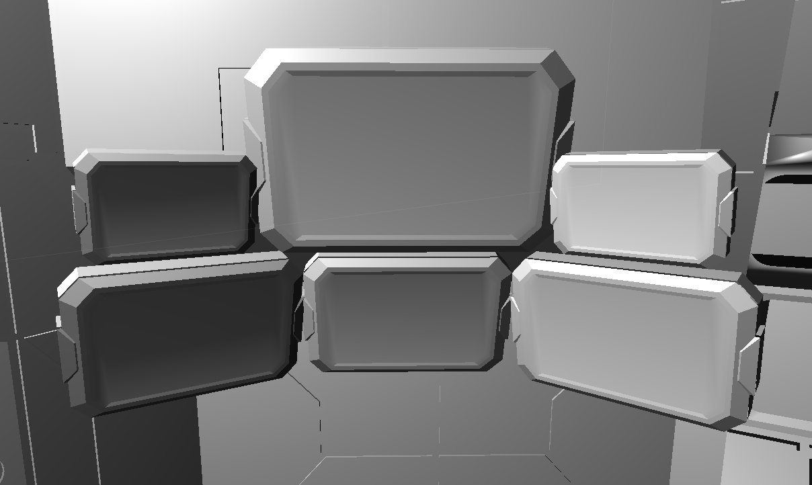

#### Partial Breach

`_BreachAmount = 0.5`  
`_BreachColour = Red`  
`_PulseSpeed = 3`  
`_CorruptionStrength = 0`

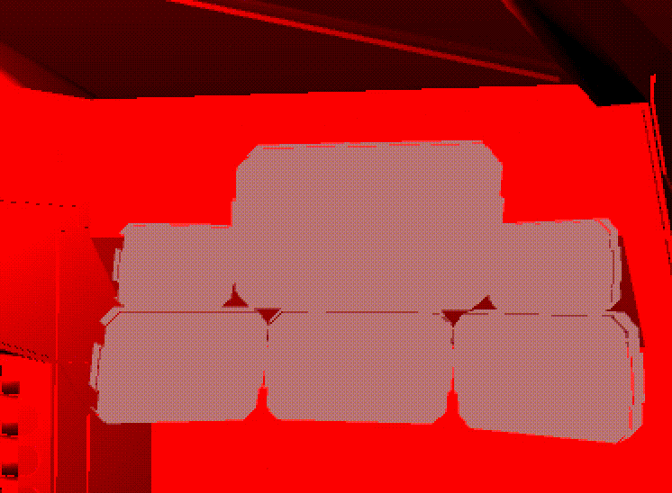

#### Full Breach

`_BreachAmount = 1`  
`_BreachColour = Red`  
`_PulseSpeed = 3`  
`_CorruptionStrength = 0`

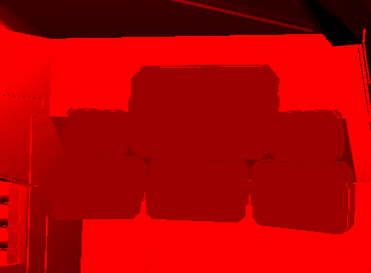

#### High Pulse

`_BreachAmount = 1`  
`_BreachColour = Red`  
`_PulseSpeed = 8`  
`_CorruptionStrength = 0`

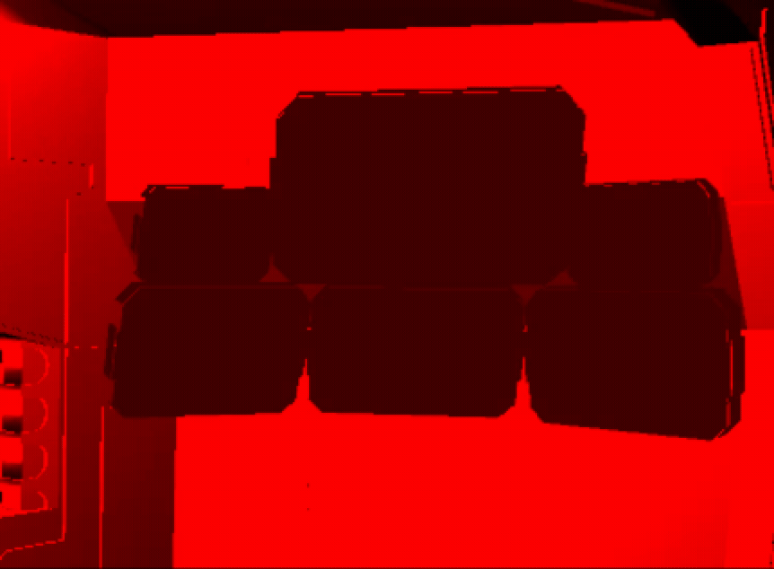

#### Low Corruption

`_BreachAmount = 1`  
`_BreachColour = Red`  
`_PulseSpeed = 3`  
`_CorruptionStrength = 1`

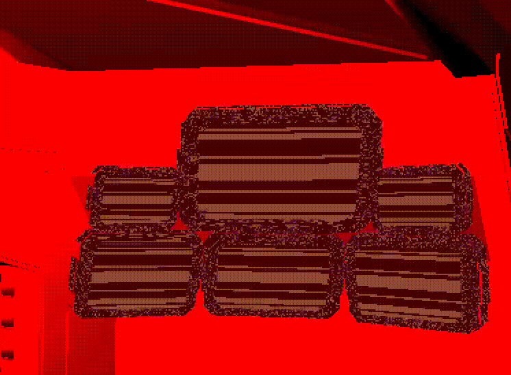

#### High Corruption

`_BreachAmount = 1`  
`_BreachColour = Red`  
`_PulseSpeed = 3`  
`_CorruptionStrength = 2`

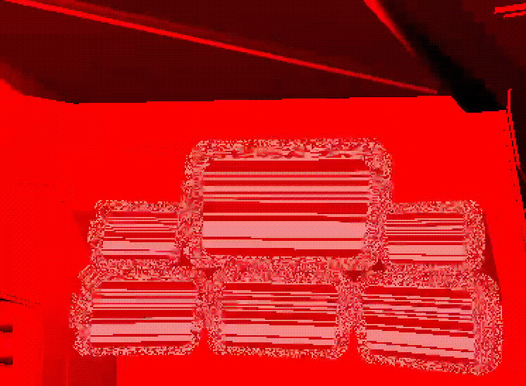

### References

- Unity Documentation: [Writing vertex and fragment shaders](https://docs.unity3d.com/Manual/SL-ShaderPrograms.html)
- Unity Documentation: [ShaderLab: Properties](https://docs.unity3d.com/Manual/SL-Properties.html)

# Turret Activation System - TurretTop & TurretBase

**Author:** Rishabh Maheshwari

## Shader Source Files

* `Assets/Shaders/TurretTop.shader`
* `Assets/Shaders/TurretBase.shader`

## Shader Effect

This feature consists of two custom shaders applied to different parts of the Room 1 turret. Both are written in handwritten Cg/HLSL and are driven by gameplay through the `_Activation` parameter.

**TurretTop.shader** controls the rotating turret head. When the turret is inactive, the shader preserves the original texture while reducing its brightness to create a powered-down appearance. As the turret activates, the lighting smoothly returns to its fully illuminated state, allowing the model to remain visually consistent with the rest of the environment.

**TurretBase.shader** controls the pedestal. Three horizontal cyan energy bands are generated procedurally using UV coordinates and appear only while the turret is active. The bands remain fixed around the base and provide a clear indication that power is flowing through the turret.

## Chosen Theme

**Theme 2 — Surface Appearance and Procedural Effects**

The shaders modify the surface appearance of the turret through procedural lighting and emissive masking rather than using particle systems or pre-authored animations.

## Design Justification

The turret is one of the most frequently viewed objects in the game because the player observes combat through surveillance cameras. A clear visual distinction between active and inactive turrets improves readability without introducing additional UI elements.

The cyan glow was chosen to match the plasma projectile shader used by the turret bullets. Using the same colour palette creates a consistent visual language across the weapon system: the illuminated bands represent stored energy, while the projectile appears to be discharged from that same energy source. This connection reinforces the game's narrative that the turrets are extensions of the ship's awakening through the NEXUS fragment rather than conventional mechanical upgrades.

The powered-down lighting on the turret head complements this idea by suggesting that the machine is dormant instead of destroyed. Keeping the original material visible also preserves the model's detail and prevents the turret from disappearing into the dark environment.

## Unity Inspector Parameters

### TurretTop.shader

* **`_Activation`** — Controls the transition between powered-down and active lighting.
* **`_ShadowBrightness`** — Sets the brightness of the inactive turret.
* **`_Shininess`** — Controls the sharpness of specular highlights.
* **`_SpecularStrength`** — Adjusts the intensity of the reflective highlight.

### TurretBase.shader

* **`_Activation`** — Enables or disables the energy bands.
* **`_GlowColor`** — Colour of the illuminated bands.
* **`_GlowIntensity`** — Brightness of the cyan glow.
* **`_BandCenter`** — Vertical UV position of the middle band.
* **`_BandSpacing`** — Distance between the three bands.
* **`_BandWidth`** — Thickness of each band.
* **`_BandSoftness`** — Smooth falloff at the band edges.

## Technical Implementation

**TurretTop.shader** transforms vertices into clip space and passes UV coordinates, world-space normals, and world position to the fragment shader. The fragment stage samples the original texture and applies a custom Blinn–Phong lighting model with a fixed light direction. `_Activation` interpolates between reduced brightness and full illumination, producing the powered-down effect while preserving the original colours.

**TurretBase.shader** uses the same lighting model before generating three horizontal emissive bands procedurally from `UV.y`. Each band is created with soft masks using `smoothstep`, producing clean transitions without requiring additional textures. The glow is multiplied by `_Activation`, ensuring that the bands appear only when the turret is powered.

## Effect Screenshots

### Turret Deactivated (Powered-Down Lighting) to Turret Activated (Horizontal Energy Bands)

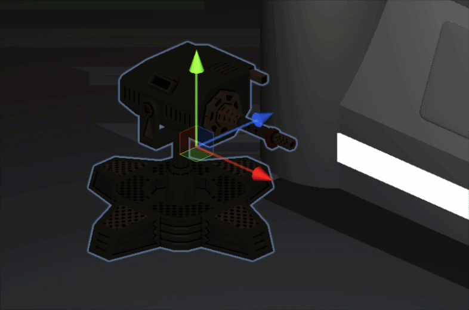

## References

* Unity Documentation: *Writing vertex and fragment shaders*
* Unity Documentation: *ShaderLab Properties*

# Contribution Report

This section summarises each team member's contribution to Project: Breach, based on the repository's commit history (22 Sep – 4 Nov 2026). Several commits were squashed or merged by Rongze Han during integration; where this happened, the original author of the work is credited.

## Rishabh Maheshwari

**Git identities:** `rishabh-uni`, `Rishabh-M-M` (same person)

**Areas owned:** turret upgrade system, shields, traps, combat audio, wave/combat balancing, Game Design Document (GDD) and README.

### Turret upgrades and combat
- Built the turret upgrade logic and the individual upgrade paths: DB turret upgrade, SS upgrade, HI Laser upgrade, Rocket upgrade (including rocket bug fixes and the controller upgrade), and applied upgrades to all turrets and the main room turrets.
- Fixed the base/shot visual bug, added turret rotation and the upgrade description text shown in the upgrade menu.
- Differentiated enemy attacks and performed turret and combat balancing passes.

### Shields
- Created the shield system: shield prefab and later prefab updates, shield shatter effect, and the shield hitbox fix.

### Traps
- Implemented the trap system: base traps, the Stasis trap, the Trapgroup prefab, trap slots, and room prefab updates to hold traps. Fixed trap bugs in later commits, and the game over flow.
- (Project 1 carry-over: Spike Trap and Spike Trap AOE.)

### Audio
- Created the Turret Audio Manager, including muting turret audio for rooms that are not currently open, plus audio and sniper sound fixes.

### Shaders
- Wrote the `TurretTop` and `TurretBase` activation shaders and the associated report section and activation GIF (see the Turret Activation System section above).

### Balancing, polish and documentation
- Wave balance passes (waves 3 and 5), main menu scaling, prefab clean-up and removal of old scenes.
- Authored the GDD (including images) and README updates.

## Rongze Han

**Git identity:** `rongze-han`

- Project lead for integration: project set-up and migration from Project 1, merge and branch management, repository clean-up and asset size reduction (texture down-resolution, removed old assets).
- Core systems: room construction, wave system and wave manager, electricity/power economy, game loop, game over, HP bar, room order and rotation, passive buffs, Comms Room, discount and energy changes.
- Enemy manager and spawning fixes, including spider spawn and room 4 fixes.
- UI integration and the start scene; WebGL video fix and video upload.
- Plasma projectile shader and report section; particle system (ExplosionEffect) report.
- Playtest survey evaluation data and report sections.

## Marcus Minnelli

**Git identity:** `Marcus-Minnelli`

- Enemy systems: ranged enemy logic, spider and flying enemies, improved enemy spawning, enemies attacking shields, enemy audio, hit reaction applied to all enemies.
- Boss system: boss event manager, boss event buttons and visuals, boss model, boss in the wave system (wave 5), boss audio, and camera and turret jams.
- Shaders: HitReaction shader, boss spawn/despawn shader, boss shader improvements, enemy shader fixes.
- Report: HitReaction section, shader report updates, GIFs and links, and the contribution report update.
- Button size adjustments.

## Hitarrth Chheda

**Git identity:** `Hitarrth-Chheda`

- Player-facing systems: room cameras and camera feeds, camera UI (REC indicator and timer), room switching, room buttons and view cameras, minimap, tutorial, boss skip button.
- Power system and fixes; upgrade menu and its fixes; main room turret button; doors and lights; trap linking.
- Main menu and start scene; screens and the Nexus; UI improvements, bug fixes and end screen fixes.
- Shaders: BreachRoom shader and Breach mode (red pulsing lights and screen effects), plus the latest shader and shader report update.

