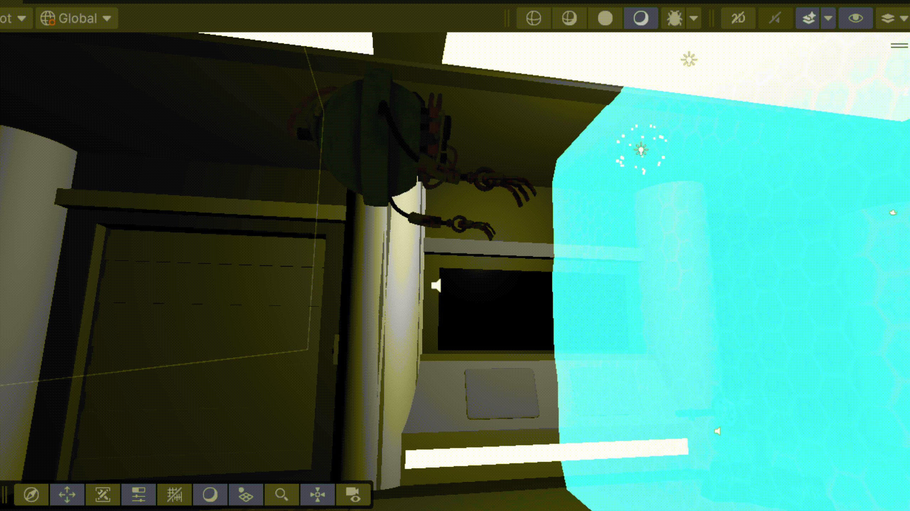
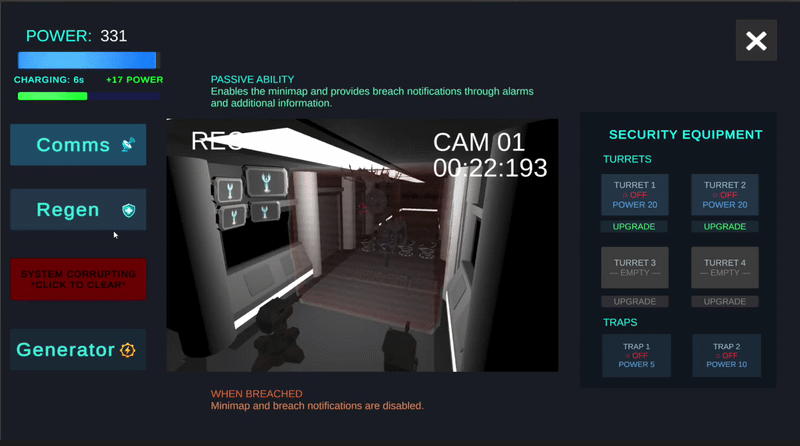
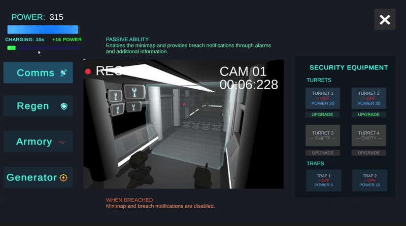
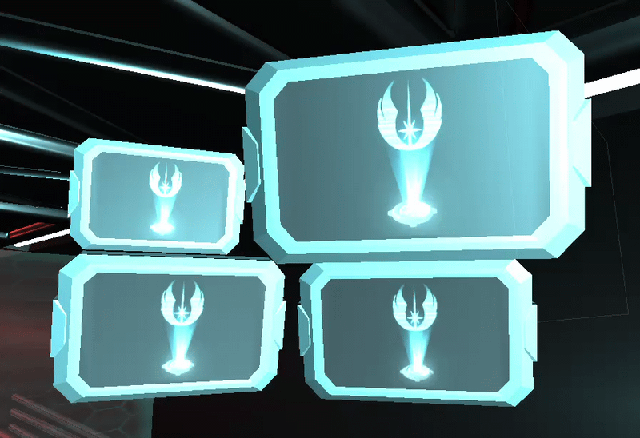
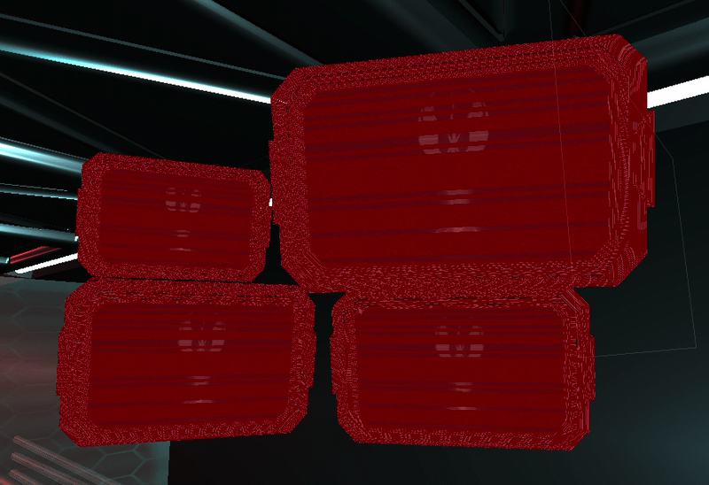
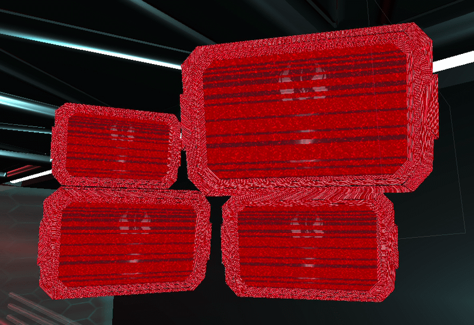
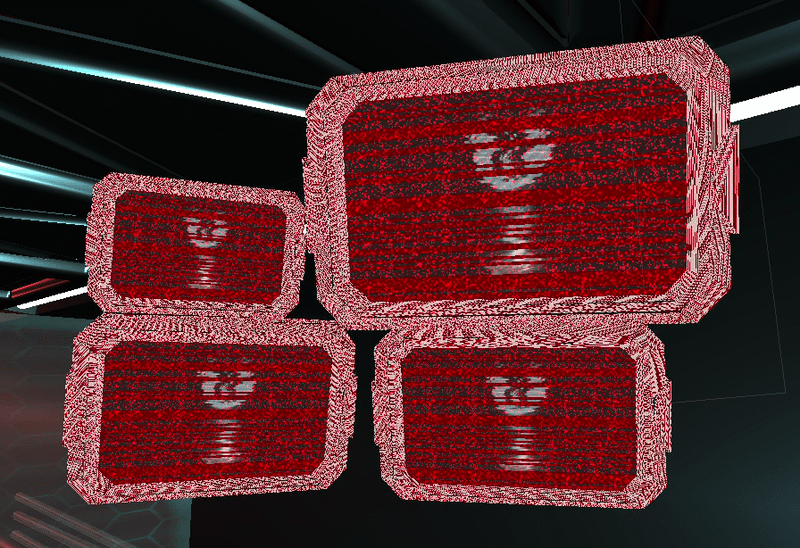
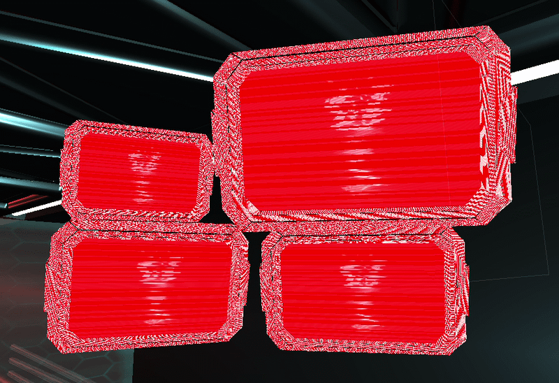

# Evaluation Planing
---

# 1. Evaluation Techniques

## Technique 1: Observational Methods – Post-task Walkthroughs

**Participants:** 5

**Reason of Choice:** BREACH is a fast-paced game that focuses on resource management and rapid camera switching. If players were to use the "Think-Aloud" technique, it would interrupt their concentration and ruin the atmosphere of the game, which relies on a claustrophobic environment to create tension. Recording gameplay and asking questions afterwards using the video footage is a better, non-interruptive method.

**Playtest Task:** Participants will play through the demo, aiming to reach the end of Wave 5. Their objective is to preserve as much Barrier HP as possible and minimise the number of enemies that breach the Main Control Room by managing the four external rooms. The experimenter will avoid helping unless a technical issue prevents the session from continuing.

During the session, the experimenter will note timestamps where players hesitate, overlook a warning, switch cameras repeatedly, run low on Power, or lose a room. These moments will guide the post-task questions.

## Technique 2: Query Techniques – Questionnaires

**Participants:** 5

**Reason of Choice:** Questionnaires allow us to collect quantitative data about the user interface and difficulty level. Open-ended questions will also help us understand whether players understand the core mechanics and narrative.

**Playtest Task:** Participants will play through the demo, attempting to reach Wave 5, then complete an online structured survey. They should answer based on their own experience rather than what they think the game intends them to do.

---

# 2. Designed Questions

These questions focus on the game's mechanics, UI/UX, difficulty, audio feedback, and narrative. Questions during the post-task walkthrough can be adjusted to match what the participant actually did.

## A. Questions for Post-task Walkthroughs

*(These questions will be asked while reviewing the gameplay video. They can be adapted to the participant's actions.)*

**On Multitasking & Camera Switching:**

> "In this video, you focused on [Room A] and ignored [Room B] for some time. Was that a chosen strategy, or was it difficult to keep track of both rooms?"

**On Resource Management:**

> "At this point, you decided to [save Power / use Power / turn off a turret / purchase an upgrade]. Can you explain your reasoning?"

**On UI & Feedback Awareness:**

> "When [a room came under pressure / a barrier took damage / an alarm appeared], did you notice the UI change straight away? How did it affect your next move?"

**On Combat and Room States:**

> "When [a turret was switched off / a turret was destroyed / a room was lost], what did you think had happened? Was it clear what you could do next?"

**On Audio Feedback:**

> "Could you tell what was happening in rooms you were not currently watching from the sounds alone, or did you need to switch back to the camera to understand?"

**On Difficulty:**

> "Was there a point where the game felt unfair or overwhelming? What was happening at that time?"

## B. Questions for Questionnaires

These questions will be asked through a Google Form after the participant finishes their playthrough.

**Scalar Questions (1 = Strongly Disagree, 5 = Strongly Agree):**

1. **Core Mechanic:** "The notion of Power as an allocatable resource, rather than just another consumable currency, was clear and understandable."
2. **UI/UX Clarity:** "The room sidebar and camera controls made it clear which rooms I was viewing and which rooms needed attention."
3. **Power Feedback:** "It was clear when I had enough Power to activate a device or purchase an upgrade, and when Power was unavailable."
4. **Room State Feedback:** "It was clear when a barrier was damaged, a turret was lost, or a room was no longer safe."
5. **Difficulty Curve:** "The progression from Wave 1 towards Wave 5 felt fair and gave me time to adapt."
6. **Audio and Atmosphere:** "Visual and audio feedback helped me understand what was happening and created a tense atmosphere."
7. **Controls:** "Switching between rooms and managing their defences felt manageable under pressure."

**Open-ended Questions:**

1. "What was the most difficult or annoying part of managing four rooms at once?"
2. "Was there any point where the Power system or an upgrade cost confused you? If so, what happened?"
3. "Were any warnings, room states, or device states easy to miss?"
4. "Did you understand the narrative twist that reveals the player is the AI and the enemies are a containment team? How did this change your understanding of the game?"
5. "If you could change one thing about the demo, what would it be?"

---

# 3. Participants

**Recruitment Strategy:** We will recruit a total of 10 participants: 5 for post-task walkthroughs and 5 for questionnaires. Recruitment will focus on IT and Computer Science students, as well as friends and gamers in Discord.

**Qualifying Criteria:** Participants should have experience with at least one of the following genres:

- **Tower Defense (TD) Games:** such as Plants vs. Zombies or Arknights.
- **Surveillance/Management Games:** such as Five Nights at Freddy's.
- **RTS and Resource Management Games:** such as StarCraft or grand strategy games.

Since BREACH requires mouse interaction, camera switching, and resource management under pressure, participants should be comfortable using a mouse and handling multiple sources of information. We should record participants' relevant game experience so we can consider it when interpreting the results.

---

# 4. Data Collection

**For Post-task Walkthroughs (Observational Data):**

- Use screen-recording software such as **OBS** to record the complete gameplay, including room switching, device toggles, upgrade choices, and visible UI feedback.
- The experimenter will remain quiet during gameplay to preserve the intended pressure and avoid influencing the participant.
- Record timestamps for useful moments, such as hesitation, repeated camera switching, missed warnings, unexpected Power shortages, a barrier being destroyed, a turret being lost, or a room being breached.
- After the playthrough, review selected timestamps with the participant and ask the relevant walkthrough questions.

**For Questionnaires (Querying Data):**

- Use Google Forms to collect the structured ratings and open-ended responses.
- Keep the same 1–5 scale for all scalar questions, with 1 meaning Strongly Disagree and 5 meaning Strongly Agree.
- Export the responses to a spreadsheet so ratings can be summarised and open-ended answers grouped by topic.

---

# 5. Data Analysis & Success Metrics

We will use both qualitative and quantitative feedback to identify problems and decide what to change.

**Qualitative Data Analysis (Walkthroughs & Open-ended Questions):**

- Group comments by topic, such as unclear UI feedback, confusing Power costs, difficulty switching between rooms, unclear room states, combat balance, audio feedback, and narrative understanding.
- Compare what participants say with what happened in their recorded gameplay. For example, if a participant says a warning was clear but repeatedly overlooks it, this may point to a visibility or timing issue.
- Prioritise issues that occur for multiple participants or prevent them from understanding an important mechanic.

**Quantitative Data Analysis & Metrics:**

- Calculate the average score for each scalar question and use it as a baseline for usability and satisfaction.
- **Improvement Threshold:** If the average score for the UI/UX Clarity statement falls below **3 out of 5**, redesigning visual feedback and UI warnings will become a high priority before the final release.
- **Difficulty Tracking:** Record the highest wave reached by each participant and calculate the average wave reached. If most participants are eliminated around Wave 2, investigate whether enemy health, wave pacing, room pressure, or the Power economy makes the difficulty curve too steep.
- **Power Clarity:** If Power feedback receives low ratings or participants repeatedly make decisions based on an incorrect understanding of available Power, prioritise clearer feedback before simply changing the costs.
- **Issue Frequency:** Record how many participants encounter each major issue. Use frequency alongside severity; a single issue that blocks progress may still need urgent attention.

The results should guide changes, but a low score alone will not tell us the cause. We will use the recordings and written feedback to identify what needs to change.

---

# 6. Timeline

| Phase | Dates | Activities |
| --- | --- | --- |
| **Preparation Phase** | Oct 9 – Oct 12 | Ensure the WebGL build is stable and playable. Finalise and test the Google Forms questionnaire. Contact participants and schedule the five walkthrough sessions. Check that recording and the build work before each session. |
| **Execution Phase** | Oct 13 – Oct 18 | Conduct the five in-person post-task walkthroughs, recording gameplay and asking follow-up questions. Distribute the WebGL demo and questionnaire to the other five participants. |
| **Analysis Phase** | Oct 19 – Oct 20 | Review recordings and questionnaire responses. Group recurring issues, calculate average ratings, and identify the most important bugs or design problems. |
| **Iteration Phase** | Oct 20 – Oct 31 | Implement changes based on the results. Focus on combat balance, turret upgrade costs, enemy health and pacing, Power feedback, and UI clarity. Retest changes before the final Milestone 4 build. |

---

# 7. Responsibilities

To distribute the workload and use each team member's role and experience:

- **Rishabh (Combat & GDD Lead):** Design the Google Forms and feedback questions. After evaluation, focus on the turret upgrade system, economy, combat balance, and related feedback.
- **Hitarrth (Player & UI Lead):** Facilitate and conduct three of the in-person post-task walkthroughs. Focus on player controls, camera switching, UI changes, and misleading or hard-to-notice feedback.
- **Marcus (Enemy Lead):** Facilitate the remaining two post-task walkthroughs. Focus on enemy performance, player experience of the difficulty curve, and wave pacing/telegraphing.
- **Rongze (Integration Lead):** Build, test, and deploy a stable WebGL build before evaluation. After data collection, lead the team's data synthesis meeting and assist with integration of the changes.

---

# 8. Playtest Notes

To keep the evaluation consistent:

- Use the same demo build and starting conditions for all participants where possible.
- Do not explain a mechanic during the playthrough unless the participant cannot continue because of a technical problem. The aim is to see what the game communicates on its own.
- Record build/version details and any technical issues that affect a session.
- Separate bugs (something not working as intended) from usability problems (something working but difficult to understand) and balance problems (something working but feeling too easy or too difficult).
- After changes are made, run a short regression test to confirm that the fix has not broken other rooms, turrets, Power allocation, or the WebGL build.

# 9. Evaluation Results & Improvements

## 9.1 Actual Participants & Demographics
We successfully completed user evaluations with **10 participants** in total. Five evaluations were conducted through post-task walkthroughs (video review), and five via online questionnaires. 

- **Questionnaire Player Base:** 2 Tower Defense/RTS players, 2 players with Surveillance/Management game experience, and 1 casual player with no relevant experience.
- **Walkthrough Player Background:** Included a diverse range of player skill levels—from hardcore players who successfully cleared all 5 waves, to players who were eliminated by the 2nd or 3rd waves.
- **Raw Data:** The complete raw data can be found in our repository: [BREACH_playtest_survey_answers.csv](./EvaluationData/BREACH_playtest_survey_answers.csv) and [BREACH_walkthrough_transcripts.md](./EvaluationData/BREACH_walkthrough_transcripts.md). 
- **Privacy Note:** To protect participant privacy, all actual player names in the raw data have been anonymized and replaced with "Player 1" through "Player 5", and the CSV has been reformatted accordingly.

## 9.2 Data Analysis & Identified Issues
Based on the questionnaire rubric (scored out of 5) and qualitative oral feedback, the game's **audio and atmosphere scored the highest (averaging 4.2/5)**. Players reported successful immersion, noting that the alarm sound effects effectively induced tension. However, several critical issues were identified regarding UI guidance, operational controls, and overall tutorials.

- **Issue 1: Overly Complex Controls Causing "Tunnel Vision" (Score: 2.4/5)**
  - *Finding:* Forcing the player to repeatedly mouse-click to switch between all 4 rooms caused a severe operational bottleneck.
  - *Supporting Feedback:* Participant 2 (an RTS veteran) complained that by Wave 5, the game felt more like an APM (Actions Per Minute) test rather than a resource management challenge. Players struggled to rapidly switch cameras, upgrade turrets, toggle power, and set up defenses simultaneously across multiple fronts.

- **Issue 2: Power System Confusion (Score: 3.4/5)**
  - *Finding:* Many players failed to realize that while upgrades consume a portion of the permanent electricity cap, electricity itself regenerates over time.
  - *Supporting Feedback:* Participants expressed hesitation in spending electricity because the concept of a "permanent cost" seemed intimidating. As a result, players often hoarded their energy, leading to under-upgraded defenses when facing harder enemy waves.

- **Issue 3: Unclear UI & Room States (Score: 3.0/5)**
  - *Finding:* Players were unable to quickly identify in-game crises due to confusing and homogenous UI elements.
  - *Supporting Feedback:* Participant 5 mentioned that all warning indicators were colored red. By the time they cycled through cameras to identify the correct room under attack, it was already too late. Furthermore, when a room was breached, it was hard to identify which specific buff had been lost.

- **Issue 4: Difficulty Spikes & Audio Localization (Score: N/A)**
  - *Finding:* The early stages did not offer players enough breathing room to learn the core mechanics. Additionally, purely from the audio cues, it was almost impossible to identify *which* specific room was being breached.

## 9.3 Game Improvements Based on Feedback
To address the issues identified during the playtests, our team implemented the following concrete changes in the final Milestone 4 build:

- **Resolution to Issue 1 (APM & Tunnel Vision):** We adjusted enemy spawning behavior in the later waves. Instead of spreading small groups of enemies across all four rooms simultaneously, we concentrated larger waves into one or two rooms at a time. This significantly reduces the need for constant, frantic room-switching, lowering the required APM while maintaining strategic pressure.
- **Resolution to Issue 2 (Power System):** We greatly reduced the energy cost for upgrades and encouraged players to allocate energy more freely by introducing an "upgrade discount" room buff. Moreover, we increased the base energy regeneration rate from 3 points/10 seconds to 5 points/10 seconds. Experiencing a faster energy income allows players to spend electricity more confidently.
- **Resolution to Issue 3 (UI Clarification):** We redesigned the alarm system to reduce visual clutter. We removed non-critical visual alerts (e.g., "not enough electricity" is now simply a textual warning). The glaring visual and audio alarms are now exclusively reserved for severe events, such as room breaches and enemy teleportation, making crises instantly recognizable.
- **Resolution to Issue 4 (Difficulty Curve & Guidance):** We weakened the enemies in Waves 1 and 2 and restricted their spawn points to a single room. This allows players to safely start the game without needing to switch rooms immediately. Furthermore, a detailed tutorial video has been integrated at the beginning of the game to better onboard new players.

# 10. Particle System Report— ExplosionEffect

## 10.1 Direct Link

| **Asset** | **Repository Path** |
| --- | --- |
| Particle System Prefab (main) | [ExplosionEffect.prefab](Assets/Prefabs/ExplosionEffect.prefab) |
| Enemy explosion variant | [ExplosionEffect_Enemy.prefab](Assets/Prefabs/ExplosionEffect_Enemy.prefab) |
| Rocket explosion variant | [ExplosionEffect Rocket.prefab](Assets/Prefabs/ExplosionEffect%20Rocket.prefab) |
| Explosion controller script | [RocketExplosionEffect.cs](Assets/Scripts/Entities/Enemy/RocketExplosionEffect.cs) |
| Flash decay script | [FlashDecay.cs](Assets/Scripts/Entities/Enemy/FlashDecay.cs) |
| Particle material | [PlasmaTrail.mat](Assets/Materials/PlasmaTrail.mat) |

---

## 10.2 What does this partical effect do, How does it serve the game

`ExplosionEffect`one-shot Explosion partical effect，when the enemy of projectile get destroyed it would be played. It is compose by two parts

- **Main partical body**：At the point of explosion it will dispense about 25 aquatic colored particals and with in 0.4 second it will cool from bright white into transparent forming a quick fireball.
- **Flashing sub-entities `Flash`**：A aquatic light source which flash in brightness on the first frame of the explosion, after that within 0.3 seconds it will quickly deem to mimic an explosion light effect

Its contribution to the game is demonstrated with in three aspects：

1. **Interactive feedback**：projectile that collides with burst with an exaplose for player to confirm hit location
2. **Atmospheric effect**：the aquatic/ white colored plasma explosion + short blinf empahsises the game's sci-fi characteristic, and portrays a unstabke plasma weapon. furthermore the flashing light will also provide better gaming experience when most scenery are in dark lighting
3. **Gameplay Readability**：The flashing effect can tell the player quickly where combat is happening even under fast camera switch
---

## 10.3 Modified Particle Attributes and Reasoning

The key particle attributes adjusted to achieve the explosion effect, along with the reasoning behind each choice, are listed below.

| Attribute | Value | Reasoning |
| --- | --- | --- |
| **Duration** (`lengthInSec`) | 0.5 s | An explosion is a transient event; 0.5 s is enough for all particles to burst once and disappear without dragging on. |
| **Looping** | Off (one-shot) | An explosion happens only once, so it should not emit continuously — the loop is therefore disabled. |
| **Play On Awake** | On | Lets the prefab play automatically the moment it is instantiated, so no external script needs to trigger the particles themselves. |
| **Start Lifetime** | 0.4 s | The particle lifetime is slightly shorter than the total duration, ensuring every particle fades out naturally before the system stops and no lingering particles are left behind. |
| **Start Speed** | 4 | Gives particles enough initial velocity to burst outward, creating a "shockwave scattering" blast feel. |
| **Start Size** | 0.15 | Uses many small particles combined with a one-shot burst to form a dense, fine-grained fireball rather than a few large chunks. |
| **Start Color** | White → cyan `(0, 0.706, 1)` | Cyan is the game's unified energy/tech colour; the white-to-cyan ramp makes the core read as white-hot with a cyan periphery. |
| **Gravity Modifier** | 0 | This is an energy burst rather than falling debris, so gravity is disabled to let particles fly outward in straight lines, matching the intuition of an "energy explosion". |
| **Shape** | Sphere, `angle 25`, `radius 0.1`, `arc 360` | A spherical emitter with 360° omnidirectional emission scatters particles evenly in all directions instead of a single direction. |
| **Emission — Burst** | 1 burst at `time 0`, ~25 particles | The defining feature of an explosion is an instantaneous burst; firing a single burst at time zero fits the explosion semantics better than pure rate-over-time. |
| **Emission — Rate over Time** | 10 | Adds a small number of continuous particles on top of the burst, producing a short "afterglow/ember" tail after the explosion. |
| **Color over Lifetime** | Cyan → white → transparent | Mimics the temperature change of a real explosion: the core glows white-hot, then cools, darkens, and fades to transparent. The fade also lets particles dissolve instead of popping out abruptly. |
| **Max Particles** | 1000 | The cap is far above actual usage, preventing particles from being unexpectedly truncated in extreme cases. |

**Complementary adjustments to the `Flash` child object (point light + script):**

| Attribute | Value | Reasoning |
| --- | --- | --- |
| Light type / colour | Point light, cyan `(0, 0.706, 1)`, `intensity 3` | Matches the particle colour; the explosion casts a cyan flash on its first frame, reinforcing the instant sense of "energy release". |
| Light `Range` | 4 | Keeps the flash confined to a small area around the blast point, so it does not wash out the lighting of the whole room. |
| `FlashDecay.decayTime` | 0.3 s | The flash lasts only a very short time. The script uses **quadratic decay (`t * t`)** rather than linear falloff, producing a realistic "hard punch up front, short tail" flash feel. |

---

## 10.4 Randomness Usage

- **`Auto Random Seed` = on（1）**：Every realisation of the explosion prefab, Unity automatically generate a new seed, meaning every partical's burst direction, speed, vibration would be different,even when multipal enemy are hit, the explosion wouldn't seem like a copy paste of image
- Becuase of the use of 360° all directional dispense, the random seed's effect would be further enlarged, making every explosion look natural and non-repeating
- This effect does not additionally enable `Randomize Rotation Direction` or a random range on `Start Speed`, because the one-shot burst + spherical omnidirectional emission + automatic random seed already provide enough visual variation. Adding extra random parameters would instead cause the explosion to lose its stable, controlled fireball silhouette.

---

## 10.5 Gameplay GIF



(Explosion is used for both enemy and friendly projectile)


---

# 11. Shader Report
## Shader 1 - BossVortex & BossConsumeDeform

## 11.1 Theme

This pairing combines two procedural shader techniques to produce one spawn/despawn effect for the boss encounter. It most closely fits Theme 2, Surface Appearance and Procedural Effects. Both the swirling portal mask and the vortex-consumption mesh deformation are generated by maths at runtime, not pre-authored textures or animation clips.

## 11.2 Why This Effect Was Chosen

The boss is a decoy rather than a persistent entity, so without a clear transition it would simply pop in and out of existence, which reads as a bug rather than a deliberate reveal. The team's collective idea was for the boss to look like it emerges from, and is pulled back into, a black-hole-style vortex. The two shaders can't be merged (BossVortex paints an unlit flat portal, while BossConsumeDeform deforms and lights the boss's own 3D mesh), but both read the same `_Progress`-driven timing from `BossSpawnEffect.cs`, so the portal opening and closing and the boss spiralling into it always stay in sync, reading as one combined effect rather than two separate ones.

## 11.3 BossVertex Shader
**Source file:** [BossVertex.shader](./Assets/Shaders/BossVertex.shader)

An unlit fragment shader on a flat quad. It samples a noise texture through a polar-coordinate swirl (UV converted to radius/angle, angle offset by radius and time) and tints the result between a core and rim colour. A radius mask driven by _Progress reveals the quad outward from its centre, with _EdgeSoftness softening the edge, this is what makes it read as a vortex opening and closing rather than fading.

### Usage in the Game
Applied to the "Vortex" quad, a child of the boss prefab (BossDecoyRoot), beneath the boss model. BossSpawnEffect.cs drives _Progress on spawn and despawn, opening it to full radius partway through the effect then closing it again, a vortex opening to let the boss through, then sealing shut.

### Setup
_Progress is set every frame from [BossSpawnEffect.cs](./Assets/Scripts/Entities/Boss/BossSpawnEffect.cs):

```
float vortexT = Mathf.Clamp01(t * vortexSpeedMultiplier);

SetVortexProgress(Mathf.Sin(vortexT * Mathf.PI) * maxVortexProgress);
```

`vortexRenderer`, `maxVortexProgress` and `vortexSpeedMultiplier` are serialised fields on BossSpawnEffect, tuning the vortex's peak openness and speed without touching code.

The rest are Material-level properties:

• `_MainTex` - noise texture for the swirl.

•` _CoreColor` / `_RimColor` - colours blended across the radius.

• `_SwirlSpeed` / `_SwirlTightness` - spiral rotation speed and tightness.

• `_EdgeSoftness` - softness of the radius mask's edge.


## 11.4 BossConsumeDeform Shader

**Source file:** [BossConsumeDeform.shader](./Assets/Shaders/BossConsumeDeform.shader)

A Surface Shader on the boss's own mesh, keeping standard Unity lighting while adding a custom vertex function. Vertices near the feet reach a "consumed" state before those near the head, as _Progress rises from 0 to 1. Consumed vertices spiral around the vertical axis and pull inward and down toward the vortex plane, rather than just scaling down. This makes it look like it is being spun and sucked in, not shrunk.

### Usage in the Game
Applied as the boss model's material, replacing its default Standard one. Driven by the same `BossSpawnEffect.cs`: `_Progress` is set to 1 - `curveValue`, so the mesh is always exactly as "consumed" as it is "shrunk", for both spawn and despawn.

### Setup
`_Progress` is set every frame via the same MaterialPropertyBlock pattern, across every renderer under the boss's visual root:

```
private void SetBossConsumeProgress(float value)
{
    if (bossRenderers == null) return;
    foreach (Renderer r in bossRenderers)
    {
        r.GetPropertyBlock(propertyBlock);
        propertyBlock.SetFloat(ProgressID, value);
        r.SetPropertyBlock(propertyBlock);
    }
}
```

The rest are tuned on the boss's Material:
• `_MainTex` / `_Color` / `_Glossiness` / `_Metallic` - matched to the boss's original material.
• `_ModelHeight` - local height, feet to head; normalises the vertical wipe.
• `_WipeSoftness` - how gradual the feet-to-head wave is.
• `_TwistAmount` - spiral rotation on fully consumed vertices.

### GIFs


(Boss leaving when getting cleared by the player)




(Boss spawning in front of camera, external static effect applied on top)

### External Resources

• [Unity Documentation: Writing vertex and fragment shaders](https://docs.unity3d.com/462/Documentation/Manual/SL-ShaderPrograms.html)

• [Unity Scripting API: MaterialPropertyBlock](https://docs.unity.com/en-us/engine/6000.6/script-reference/unityengine/materialpropertyblock)


# 11. Shader Report

## Shader 2 - BreachRoom

## 11.5 Theme

This shader fits Theme 2, Surface Appearance and Procedural Effects. It uses custom vertex and fragment shader programming to create an increasingly corrupted appearance across the main room's security screens. The distortion, glitching, electrical cracks and digital interference are generated procedurally at runtime rather than relying on pre-authored damage textures or animations.

## 11.6 Why This Effect Was Chosen

As enemies breach the player's defences and more rooms fall, the main control room becomes increasingly vulnerable. The team wanted this progression to be reflected visually, rather than communicating danger only through gameplay events or UI warnings. The shader transforms the security screens into a visual indicator of the game's escalating threat. Its red pulsing, signal interference and electrical corruption become more intense across four breach levels, reinforcing the feeling that the security system is progressively failing.

## 11.7 BreachRoom Shader

**Source file:** [BreachRoom](./Assets/Shaders/BreachRoom.shader)

A custom Cg/HLSL vertex and fragment shader applied to the main room's security screens. The vertex stage uses animated sine and cosine waves with procedural noise to displace screen vertices, creating subtle geometric distortion. The fragment stage combines seven effects: heat distortion, red pulsing, horizontal glitch bands, digital scanlines, procedural electrical cracks, digital static and red edge glow. These effects are controlled independently and become stronger as the breach level increases, making the screens appear increasingly unstable and corrupted.

### Usage in the Game

Applied to the main room's screen renderers through `BreachController.cs`, replacing their original materials temporarily while preserving their screen textures. When a breach occurs, the shader activates alongside red pulsing lights, breach audio and camera shake. The effect lasts five seconds, after which the original screen materials and light settings are restored.

The shader is also connected to room progression. `MainControlRoom.cs` tracks fallen rooms and passes the number of fallen rooms to `BreachController.SetPermanentBreachLevel()`. This selects one of four corruption profiles, ensuring subsequent breach events reflect the current game progression.

### Setup

The controller creates temporary material instances using the `Custom/BreachRoom` shader and applies the shader properties through `Material.SetFloat()` and `Material.SetColor()`.

The main parameters are:

- `_BreachAmount` / `_BreachColour` - overall effect intensity and corruption colour.
- `_PulseSpeed` / `_PulseIntensity` - red pulse speed and intensity.
- `_CorruptionStrength` / `_BreachLevel` - overall corruption and progression-based scaling.
- `_HeatDistortionStrength` - animated heat distortion.
- `_GlitchStrength` - horizontal signal interference.
- `_ScanlineStrength` - digital scanline visibility.
- `_CrackStrength` - procedural electrical crack intensity.
- `_StaticStrength` - digital static and flashing interference.
- `_EdgeGlowStrength` - red glow around screen edges.

Four `BreachLevelProfile` configurations in `BreachController.cs` control the values of these parameters:

| Setting | Level 1 | Level 2 | Level 3 | Level 4 |
| --- | ---: | ---: | ---: | ---: |
| Pulse Speed | 3.5 | 4.5 | 6 | 8 |
| Corruption | 0.5 | 0.9 | 1.4 | 2 |
| Heat Distortion | 0.5 | 0.8 | 1.3 | 1.8 |
| Horizontal Glitch | 0.4 | 0.8 | 1.3 | 2 |
| Scanlines | 0.35 | 0.65 | 1.1 | 1.6 |
| Electrical Cracks | 0.2 | 0.6 | 1.1 | 1.8 |
| Digital Static | 0.2 | 0.6 | 1.2 | 2 |
| Edge Glow | 0.45 | 0.8 | 1.3 | 2 |
| Pulse Intensity | 0.6 | 0.9 | 1.3 | 1.8 |

These profiles allow each corruption stage to be tuned independently through the Unity Inspector without modifying the shader code.

### GIFs



(Original security screen appearance before any breaches occur. No corruption, distortion, glitching or electrical effects are applied.)



(Initial screen corruption with subtle distortion and red pulsing.)



(Stronger glitching, scanlines and electrical cracks.)



(Severe screen distortion with increased static and red glow.)



(Maximum configured corruption with intense interference and electrical effects.)

### External Resources

- Unity Documentation: [Writing vertex and fragment shaders](https://docs.unity3d.com/ru/current/Manual/ShaderTut2.html)
- Unity Documentation: [Built-in shader include files](https://docs.unity.com/en-us/engine/6000.3/manual/materials-and-shaders/shaders/writing-shaders-birp/use-built-in-shader-methods-birp/sl-builtin-includes)
- Unity Documentation: [Accessing shader properties in Cg/HLSL](https://docs.unity.com/en-us/engine/6000.3/manual/materials-and-shaders/shaders/writing-custom/shader-writing/writing-shader-change-properties/sl-properties-in-programs)


# Contribution Report

## Jason Han
- wave spawning and pacing system
- timed waves and rest periods between them
- along with the logic for what happens when a room's shield fails and enemies breach into the Main Control Room.
- turret and enemy projectiles and pathing
- power system and power increasing over time
- contributed to fixing bugs across the project
- project integration lead: set up the Project 2 repository, migrated Project 1 files, and managed branch merges and conflict resolution throughout development
- built the core game loop and room construction, including the Comms Room, passive room buffs and the upgrade discount buff
- wired the UI into the core systems: HP bars, room order and rotation, start scene and game over flow
- built and deployed the WebGL build, fixed WebGL video playback (mp4), and reduced asset and texture sizes for performance
- enemy manager fixes, spider spawn and enemy room fixes
- wave 5 end fix, energy regeneration and electricity system changes after playtesting
- evaluation: collected and anonymised the raw survey and walkthrough data, and wrote the evaluation results and improvements section
- wrote the Particle System Report (ExplosionEffect)

## Hitarth Chheda
- all cutscenes and their transition into gameplay
- the multi-room camera-switching UI and equipment panel
- the room models
- shader used for the room breach visual
- in-game tutorial.
- room camera setup, camera feeds and the camera UI (REC indicator and recording timer)
- Breach mode: red pulsing lights, camera effects and BreachController integration
- room-switching buttons, close button and view-cameras controls
- minimap and the main room turret button
- turret upgrade menu and its fixes, plus linking traps into the UI
- doors and lights
- main menu and start scene, screens and the Nexus
- power system UI integration and power fixes
- boss skip button, end screen fixes and general bug fixes
- facilitated three of the post-task walkthrough sessions

## Rishabh Maheshwari
- turrets controls
- turret firing
- turret upgrades
- power on/off economy
- traps
- room shields
- majority of the GDD.
- individual turret upgrade paths (DB, SS, HI Laser and Rocket), upgrade logic and upgrade descriptions shown in the menu
- Turret Audio Manager, including muting turret audio in rooms that are not open, and sniper and sound fixes
- shield prefab, shield shatter effect and shield hitbox fix
- trap system: Stasis trap, trap group prefab, trap slots, and room prefabs that hold traps
- differentiated enemy attack types
- turret, combat and wave balancing passes, including waves 3 and 5 after playtesting
- main menu scaling, prefab updates and removal of old scenes
- README, GDD images and GDD updates
- designed the Google Forms questionnaire and feedback questions

## Marcus Minnelli
- enemy models and animations
- enemy movement
- enemy attacking and health
- enemy spawning
- enemy integration with shields and turrets
- boss model and shading
- boss integration with the camera, turret controls, and wave system
- ranged, spider and flying enemy types, with hit reactions applied to all enemies
- enemy and boss audio, including boss spawn audio
- boss event manager, event buttons and event visuals, which jam cameras and turrets
- boss spawn and despawn shaders (BossVortex and BossConsumeDeform), plus the HitReaction and enemy shader fixes
- boss placement in wave 5 and removal of duplicate bosses from scenes
- button size adjustments
- facilitated two of the post-task walkthrough sessions
- report GIFs, links and the shader report sections
